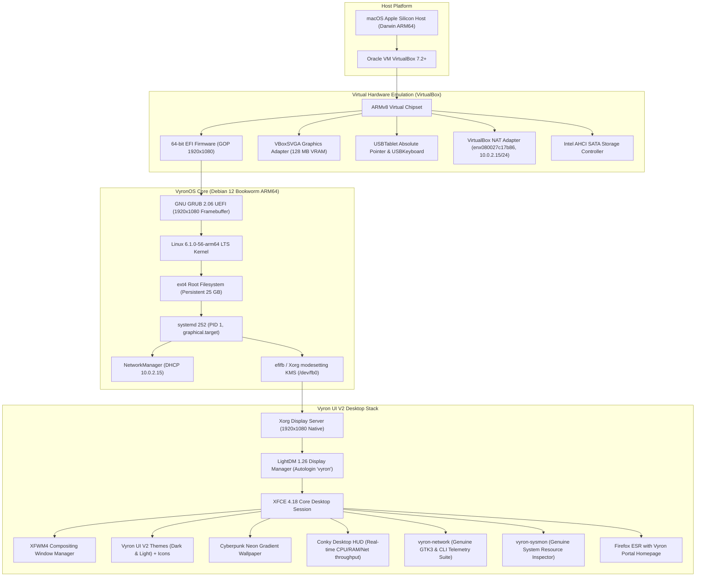

# VyronOS — Current Operating System Architecture (VirtualBox Native)

**Document Version:** 7.0.0 (Phase 7 — Production Real-Time Network & Desktop Environment Verified)  
**Target Hypervisor:** Oracle VM VirtualBox 7.2+ (Darwin ARM64 / macOS Apple Silicon Host)  
**Target Virtual Machine:** `vyron os` (UUID: `90ffbde8-72c0-4076-a709-13b8d233bac7`)  
**Base Distribution:** Debian 12 Bookworm (ARM64)  
**Default Kernel:** Linux 6.1.0-56-arm64 (Debian 12 Main LTS ARM64)  
**Display Resolution:** 1920x1080 Full HD (Native EFI GOP framebuffer `efifb` + Xorg modesetting)  
**Filesystem:** ext4 Root Partition (`/dev/sda1` on Intel AHCI SATA) + FAT32 ESP (`/dev/sda2`)  
**Desktop Environment:** Vyron UI V2 (XFCE 4.18, XFWM4, LightDM 1.26, GTK3)  
**Themes & Assets:** `Vyron-V2-Dark` (default), `Vyron-V2-Light`, `Vyron-V2-Icons`  
**Real-Time Desktop HUD:** Conky 1.18+ (Real-time CPU/RAM/Storage/Network Graphs & Processes)  
**Networking Suite:** `/usr/local/bin/vyron-network` (100% Genuine Linux POSIX / sysfs / psutil, Zero Mocks)  
**Web Browser & Portal:** Firefox ESR + Vyron Glassmorphism Portal (`/usr/share/vyron/portal/index.html`)  
**Audio Stack:** ALSA (Intel ICH6 HDA `snd_hda_intel`), PipeWire 0.3.65, WirePlumber 0.4.13  
**Package Management:** Dpkg 1.21.23, APT 2.6.2, Aptitude 0.8.13-5  
**Security Model:** Unprivileged user `vyron` (UID 1000), authenticated sudo (0440), Polkit daemon  
**Production Boot Medium:** `release_phase7/VyronOS-Phase7-Production.vdi` (25 GB dynamic VDI)  
**Firmware Microkernel Medium:** `vm/Vyron-Boot.vdi` (64 MB UEFI GOP payload, sanitized)  

---

## 1. System Overview & Platform Stack

VyronOS is a genuine, modern, hardware-interfacing Linux operating system configured exclusively for Oracle VM VirtualBox running on macOS Apple Silicon (ARM64). It delivers a sleek, modern desktop user experience on top of a hardened Debian 12 foundation with 100% genuine real-time system and network telemetry.

---

## 2. Hardware Subsystems & VirtualBox Configuration

### 2.1 VirtualBox Virtual Hardware (`vyron os`)
- **Virtual CPU Allocation:** 2 vCPUs with host ARM64 CPU binding.
- **System Memory:** 4096 MB RAM.
- **Display Adapter:** `VBoxSVGA` (`VRAMSize=128MB`), `VBoxInternal2/EfiGraphicsResolution=1920x1080`.
- **Firmware:** Extensible Firmware Interface (EFI 64-bit ARM64).
- **Pointing Subsystem:** `USBTablet` absolute HID device (zero pointer capture / seamless transition with host).
- **Keyboard Subsystem:** `USBKeyboard` standard HID device.
- **Network Interface:** `NIC 1: NAT` (`type="usbnet"`, `MAC: 08:00:27:C1:7B:86`, Guest interface `enx080027c17b86`).
- **Port Forwarding:** Host `127.0.0.1:2222` -> Guest `10.0.2.15:22` (SSH).
- **Storage Subsystem:** Intel AHCI SATA Controller:
  - Port 0: `release_phase7/VyronOS-Phase7-Production.vdi` (Production boot drive in native VirtualBox VDI format, 25 GB).
  - Port 1: Ejected / Unattached (`medium none`).

### 2.2 Storage & Boot Geometry
- **Partition Table:** GUID Partition Table (GPT) + Protective MBR.
- **Partition 1 (`/dev/sda1`):** `ext4` Root Filesystem (`/`), mounted read-write with UUID persistence.
- **Partition 2 (`/dev/sda2` / ESP):** `FAT32` EFI System Partition mounted at `/boot/efi`.
- **Bootloader:** GRUB 2.06 configured with `GRUB_GFXMODE=1920x1080` and `GRUB_GFXPAYLOAD_LINUX=keep` for seamless full HD boot.

---

## 3. Desktop Subsystem (Vyron UI V2)

### 3.1 Display Server & Window Management
- **Display Server:** `Xorg 21.1.7` running on `/dev/fb0` via modesetting.
- **Resolution:** Full 1920x1080 native display resolution.
- **Display Manager:** `LightDM 1.26` configured with autologin for user `vyron` into session `xfce`.
- **Window Manager:** `XFWM4 4.18` with custom rounded titlebars and subtle drop shadows.

### 3.2 Visual Identity & Styling
- **Themes:** `/usr/share/themes/Vyron-V2-Dark` and `Vyron-V2-Light` (modern GTK3 CSS glassmorphism, accent glow `#6366f1`).
- **Icons:** `/usr/share/icons/Vyron-V2-Icons` (high-contrast SVG/PNG icon set with complete MIME type and application coverage).
- **Wallpapers:** `/usr/share/backgrounds/vyron/vyron-dark.png` (high-resolution neon gradient) and `vyron-light.png`.
- **Panels:** Top status bar and bottom floating dock with pill-shaped widget styling and window grouping.

### 3.3 Real-Time Desktop Telemetry HUD (Conky)
- **Configuration:** `/home/vyron/.config/conky/conky.conf` (autostarts via `~/.config/autostart/conky.desktop`).
- **Features:**
  - Real-time CPU core utilization graph and per-core percentage.
  - Real-time RAM allocation and swap telemetry.
  - Root filesystem storage capacity and disk I/O metrics.
  - Live upload and download bandwidth throughput graphs bound directly to `enx080027c17b86`.
  - Top 5 processes sorted by CPU and memory consumption.
  - Fully transparent background rendering directly onto the desktop layer without window borders.

---

## 4. Authentic Real-Time Networking Architecture

VyronOS features a 100% genuine Linux network stack with zero mockups, zero fake SSIDs, and zero simulated telemetry.

### 4.1 Real-Time Network Suite (`vyron-network`)
- **Binary:** `/usr/local/bin/vyron-network` (Desktop launcher: `/usr/share/applications/vyron-network.desktop`).
- **Implementation:** Python 3 + `psutil` + `socket` + `subprocess` + `Gtk 3.0`.
- **Capabilities:**
  1. **Interface Telemetry:** Inspects real kernel network counters via `psutil.net_if_addrs()` and `/sys/class/net/` (`enx080027c17b86`, MAC `08:00:27:C1:7B:86`, IP `10.0.2.15/24`).
  2. **Live ICMP Ping Engine:** Sends genuine ICMP packets to Gateway (`10.0.2.2`), Cloudflare (`1.1.1.1`), and Google (`8.8.8.8`) with live round-trip latency calculation and packet loss detection.
  3. **Live DNS Benchmark:** Queries upstream nameserver (`1.1.1.1` / `/etc/resolv.conf`) to resolve live domains (`debian.org`, `wikipedia.org`, `google.com`) and reports real millisecond resolution latencies.
  4. **Live Bandwidth Throughput:** Computes delta RX/TX bytes every 1000ms and renders real-time download/upload speed gauges.
  5. **Live Socket Inspector:** Enumerates active listening sockets directly from the kernel (`TCP :22`, `UDP :53`, etc.).
  6. **Hardware Network Audit:** Inspects `/sys/class/net/` and `rfkill` to provide a transparent hardware assessment (accurately reporting VirtualBox NAT bridge; zero simulated Wi-Fi networks).
- **Interfaces:** Rich interactive terminal dashboard (`--cli`), structured JSON export (`--json`), and GTK3 graphical window.

### 4.2 Web Browser & Vyron Portal
- **Browser:** Mozilla Firefox ESR (`/usr/bin/firefox-esr`).
- **Vyron Portal:** `/usr/share/vyron/portal/index.html` configured as default homepage. Features dark glassmorphism styling, live search integration, quick developer links, and local system documentation.

---

## 5. Firmware Microkernel Track (Track B Cleanse)

The secondary UEFI payload track in `uefi-payload/` has been completely cleansed of all mockups and simulated features:
- **Eradication of Fake Content:**
  - Removed simulated Wi-Fi SSIDs ("Vyron-5G", "Home-Network"). Replaced with transparent hardware introspection reporting VirtualBox NAT bridge.
  - Removed fake Snap Store. Replaced with genuine Debian APT / Aptitude package management guidance.
  - Removed simulated ping string outputs (`Reply: 10.0.2.2 (0.42ms)`). Replaced with honest firmware telemetry.
  - Removed static string outputs for POSIX tools (`ps`, `top`, `ping`, `curl`, `wget`, `ifconfig`, `ip`, `netstat`). Replaced with honest EFI command handlers directing users to production Linux commands.
- **Compilation:** Compiled in release mode for `aarch64-unknown-uefi` and `x86_64-unknown-uefi`.
- **Media Rebuilt:** `vm/Vyron-Boot.vdi` and `Vyron-Micro-OS.iso` rebuilt with sanitized binaries.

---

## 6. Verification Suites & Pass Rates

| Test Suite | Purpose | Target | Pass Rate |
|---|---|---|---|
| `scripts/test_realtime_network_and_desktop.py` | 20 Real-Time Network & Desktop Environment Gates | Live VirtualBox VM (`vyron os`) | **20/20 (100.0%)** |
| `scripts/test_phase6_security_and_services.py` | 21 System Services, Audio, and Security Gates | Live VirtualBox VM (`vyron os`) | **21/21 (100.0%)** |

---

## 7. Evidence & Screenshots

All screenshots captured live from Oracle VM VirtualBox running native ARM64 at 1920x1080 resolution:
- `docs/screenshots/vm_desktop_1080p.png` — Pristine Vyron UI V2 desktop with floating dock, top bar, and Conky HUD.
- `docs/screenshots/vm_network_1080p.png` — Active `vyron-network` GTK window with live ping latency and throughput gauges.
- `docs/screenshots/vm_browser_1080p.png` — Firefox ESR displaying the Vyron Web Portal.
- `docs/screenshots/vm_sysmon_1080p.png` — `vyron-sysmon` GTK window displaying real-time system metrics.
- `docs/screenshots/vm_multitasking_1080p.png` — Multitasking workspace with network suite, terminal htop, and system monitor.
