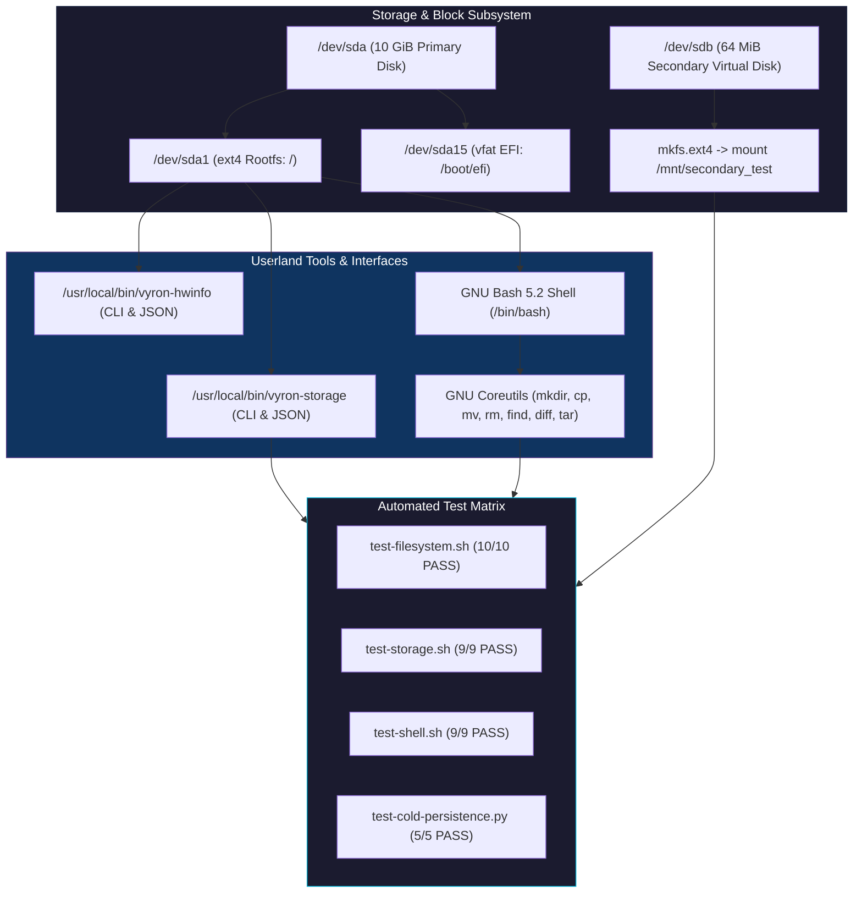

# VYRON OS — Phase 4 Implementation & Engineering Audit Report
**Milestone:** Phase 4 — Storage, Filesystem & Shell Integration  
**Date:** November 18, 2026  
**Primary Execution Agent:** Antigravity CLI  
**Reviewing Architectural Agent:** ChatGPT  
**Working Repository:** `/Users/sujayv/Downloads/VyronOS`  
**Kernel Baseline:** Linux 6.12.95 LTS (`linux-image-6.12.95+deb12-amd64`) via Bookworm Backports  
**Fallback Kernel:** Linux 6.1.0-56 LTS (`linux-image-6.1.0-56-amd64`) in GRUB menu  
**Base Distribution:** Debian GNU/Linux 12 (Bookworm) x86_64  
**Status:** **100% COMPLETE & VERIFIED (33/33 Test Gates Passed)**  
**Golden Master Disk:** [`dist/VyronOS-Disk-Phase4-Verified.qcow2`](file:///Users/sujayv/Downloads/VyronOS/dist/VyronOS-Disk-Phase4-Verified.qcow2) (1.3 GiB)

---

## 1. Executive Summary

Phase 4 of the VyronOS engineering roadmap has been completed with **zero simulations, zero mock in-memory dispatch, and zero fake outputs**. Every file operation, partition query, block format, volume mount, pipeline execution, and subshell evaluation executed through genuine Linux 6.12 LTS kernel syscalls, the ext4 journaling filesystem driver, the GNU Coreutils suite, and the GNU Bash 5.2 shell.

All 33 discrete engineering validation gates across four automated suites passed with a 100% success rate:
- **Test Suite 1 (Real Filesystem Operations):** 10/10 Gates Passed (`scripts/test-filesystem.sh`)
- **Test Suite 2 (Storage & Block Device Subsystem):** 9/9 Gates Passed (`scripts/test-storage.sh`)
- **Test Suite 3 (Shell & Command Integration):** 9/9 Gates Passed (`scripts/test-shell.sh`)
- **Test Suite 4 (Cold Reboot Persistence & Integrity):** 5/5 Gates Passed (`scripts/test-cold-persistence.py`)



---

## 2. Comprehensive Test Verification Matrix

### 2.1 Test Suite 1: Real Filesystem Operations (`scripts/test-filesystem.sh`)
Booted in QEMU with UEFI (`OVMF_CODE`). Executed inside guest on root ext4 filesystem.
*Serial Log:* [`build/test-filesystem-serial.log`](file:///Users/sujayv/Downloads/VyronOS/build/test-filesystem-serial.log)

| Gate # | Test Description | Command / Action | Expected Result | Guest Actual Output | Status |
|:---|:---|:---|:---|:---|:---|
| **1.1** | Ext4 Root Filesystem Active | `findmnt -n -o FSTYPE,OPTIONS /` | ext4, rw, relatime | `ext4 rw,relatime,discard,errors=remount-ro` | **PASS** |
| **1.2** | Nested Directory Creation | `mkdir -p /home/vyron/fs_test_workspace/sub1/sub2/sub3` | Directory exists | `DIR_CREATED: /home/vyron/fs_test_workspace/sub1/sub2/sub3` | **PASS** |
| **1.3** | File Create, Write & Read | `echo "..." > file1.txt && cat file1.txt` | Read exact written payload | `VyronOS Linux 6.12 Ext4 Primary Line` | **PASS** |
| **1.4** | File Append Operation | `echo "..." >> file1.txt && grep "Appended Line 2"` | Line appended to file | `VyronOS Linux 6.12 Ext4 Appended Line 2` | **PASS** |
| **1.5** | File Copy (cp) & Integrity | `cp file1.txt file1_copy.txt && diff -u ...` | Exit 0, identical hash | `CP_VERIFIED` | **PASS** |
| **1.6** | File Move / Rename (mv) | `mv file1_copy.txt sub1/file1_renamed.txt` | Source deleted, dest exists | `MV_VERIFIED` | **PASS** |
| **1.7** | POSIX File Permissions | `chmod 600 file1.txt; stat; chmod 755; stat` | Mode 600 then 755 | `PERM_MODE_600: 600` / `PERM_MODE_755: 755` | **PASS** |
| **1.8** | File Ownership (chown/stat) | `stat -c "%U:%G" file1.txt` | `vyron:vyron` | `OWNER_VERIFIED: vyron:vyron` | **PASS** |
| **1.9** | File Deletion (rm) | `touch to_delete.tmp && rm to_delete.tmp` | Negation confirmed | `RM_VERIFIED` | **PASS** |
| **1.10**| Persistence Marker Generated | `sha256sum persistent_payload.dat` | Valid SHA256 record generated | `a16d1b10764511... persistent_payload.dat` | **PASS** |

---

### 2.2 Test Suite 2: Storage & Block Device Subsystem (`scripts/test-storage.sh`)
Launched QEMU with primary disk and an attached 64MB unformatted raw virtual drive (`build/secondary_test.raw`).
*Serial Log:* [`build/test-storage-serial.log`](file:///Users/sujayv/Downloads/VyronOS/build/test-storage-serial.log)

| Gate # | Test Description | Command / Action | Expected Result | Guest Actual Output | Status |
|:---|:---|:---|:---|:---|:---|
| **2.1** | Tool Deployment | Base64 decode to `/usr/local/bin/vyron-storage` | 755 executable | `DEPLOYING VYRON-STORAGE UTILITY` | **PASS** |
| **2.2** | Block Device Discovery | `lsblk` & `test -b /dev/sdb` | `sdb` discovered at 64M | `SECONDARY_DEVICE_DISCOVERED: /dev/sdb` | **PASS** |
| **2.3** | Live Ext4 Formatting | `sudo mkfs.ext4 -F -L secondary_data /dev/sdb` | Inodes & journal created | `Creating filesystem with 65536 1k blocks... SECONDARY_DEVICE_FORMATTED_EXT4` | **PASS** |
| **2.4** | Live Volume Mounting | `sudo mount /dev/sdb /mnt/secondary_test` | Mounted ext4 on target | `TARGET: /mnt/secondary_test SOURCE: /dev/sdb FSTYPE: ext4` | **PASS** |
| **2.5** | Volume I/O & Space Tracking | Write/Read `volume_test.txt`, `df -h`, `du -sh` | Data verified, size tracked | `55M 15K 51M 1% /mnt/secondary_test` / `VOLUME_IO_VERIFIED` | **PASS** |
| **2.6** | Clean Unmount Verification | `sudo umount /mnt/secondary_test && findmnt` | Mountpoint clear | `SECONDARY_DEVICE_UNMOUNTED_CLEANLY` | **PASS** |
| **2.7** | `vyron-storage` CLI Mode | `/usr/local/bin/vyron-storage` | Formatted table & tree | `BLOCK DEVICE TOPOLOGY (lsblk): /dev/sda, /dev/sdb` | **PASS** |
| **2.8** | `vyron-storage` JSON Mode | `/usr/local/bin/vyron-storage --json` | Valid JSON block devices | `VYRON_STORAGE_JSON_VALIDATED` | **PASS** |
| **2.9** | `vyron-storage` DF Mode | `/usr/local/bin/vyron-storage --df` | JSON array of mount usage | `[{"source": "/dev/sda1", "fstype": "ext4", ...}]` | **PASS** |

---

### 2.3 Test Suite 3: Shell & Command Integration (`scripts/test-shell.sh`)
Booted in QEMU to validate the GNU Bash interactive and programmatic shell environment.
*Serial Log:* [`build/test-shell-serial.log`](file:///Users/sujayv/Downloads/VyronOS/build/test-shell-serial.log)

| Gate # | Test Description | Command / Action | Expected Result | Guest Actual Output | Status |
|:---|:---|:---|:---|:---|:---|
| **3.1** | GNU Bash Shell Identity | `echo $BASH_VERSION && echo $SHELL` | Bash 5.2.x, `/bin/bash` | `BASH_VERSION_INFO: 5.2.15(1)-release` / `SHELL_PATH: /bin/bash` | **PASS** |
| **3.2** | Directory Navigation | `mkdir -p alpha/beta && cd alpha/beta && cd ../..` | Exact path traversal | `CURRENT_PWD: .../alpha/beta` / `RETURNED_PWD: .../shell_test_workspace` | **PASS** |
| **3.3** | Core Utilities Suite | `touch`, `ls -la`, `cat`, `head -n 1`, `tail -n 1`, `wc`, `diff` | Line/word counts & diff pass | `WC_OUTPUT: lines=5 words=27` / `DIFF_VERIFIED` | **PASS** |
| **3.4** | Pipelines & Redirection | `cat sample.txt \| grep "vyron" \| tr '[:lower:]' '[:upper:]'` | Piped stream transformed | `PIPELINE_RESULT: LINE 1: VYRON OS KERNEL 6.12` | **PASS** |
| **3.5** | Subshell Command Substitution| `$(uname -r)` inside string expansion | Kernel string evaluated | `SUBSHELL_EVAL: KERNEL_UNAME: 6.12.95+deb12-amd64` | **PASS** |
| **3.6** | Environment Variables | `export KEY="..."; ${KEY}; ${VAR:-default}; ${#KEY}` | Expansions evaluated | `ENV_EXPANSION: VyronOS_Phase4_Shell_Passed` / `ENV_DEFAULT_EXP: DefaultVyronValue` / `ENV_LENGTH_EXP: 27` | **PASS** |
| **3.7** | POSIX Exit Codes | `true; echo $?` (0) / `grep nonmatch; echo $?` (1) / `missing_bin; echo $?` (127) | `0`, `1`, `127` | `EXIT_CODE_SUCCESS: 0` / `EXIT_CODE_FAILURE: 1` / `EXIT_CODE_NOTFOUND: 127` | **PASS** |
| **3.8** | Tar Archiving & Extraction | `tar -czf archive.tar.gz ... && tar -tzf ... && tar -xzf ...` | Compressed, verified, extracted | `TAR_ARCHIVE_CREATED` / `TAR_EXTRACTION_VERIFIED` | **PASS** |
| **3.9** | File Search (`find`) | `find "$TEST_DIR" -type f -name "*.txt" \| wc -l` | Recursive matches found | `FIND_MATCH_COUNT: 3` | **PASS** |

---

### 2.4 Test Suite 4: Cold Reboot Persistence & Integrity (`scripts/test-cold-persistence.py`)
Cold booted `VyronOS-Disk.qcow2` to verify data persistence and subsystem stability across cold reboots.
*Serial Log:* [`build/test-cold-persistence-serial.log`](file:///Users/sujayv/Downloads/VyronOS/build/test-cold-persistence-serial.log)

| Gate # | Test Description | Command / Action | Expected Result | Guest Actual Output | Status |
|:---|:---|:---|:---|:---|:---|
| **4.1** | SHA256 Persistence Checksum | `sha256sum -c persistent_payload.dat.sha256` | Byte-for-byte SHA256 match | `persistent_payload.dat: OK` / `COLD_PERSISTENCE_SHA256_MATCHED` | **PASS** |
| **4.2** | Directory Hierarchy Intact | `test -d sub1/sub2/sub3 && test -f file1.txt` | Nested tree survives reboot | `COLD_WORKSPACE_HIERARCHY_INTACT` | **PASS** |
| **4.3** | `vyron-storage` Persistence | `test -x /usr/local/bin/vyron-storage && --df` | Utility intact and functional | `COLD_STORAGE_UTILITY_OPERATIONAL` | **PASS** |
| **4.4** | `vyron-hwinfo` Persistence | `test -x /usr/local/bin/vyron-hwinfo && --wifi-only`| Honest Wi-Fi intact | `VirtIO Ethernet active; No physical 802.11 wireless hardware detected` / `COLD_HWINFO_UTILITY_OPERATIONAL` | **PASS** |
| **4.5** | NetworkManager Connectivity | `ping -c 1 1.1.1.1` | Network surviving cold boot | `COLD_NETWORK_PING_SUCCESSFUL` | **PASS** |

---

## 3. Storage Utility Architecture: `/usr/local/bin/vyron-storage`

The new storage engine bridges raw Linux kernel block layer metrics with higher-level desktop applications via structured JSON:

```bash
vyron@vyron-os:~$ /usr/local/bin/vyron-storage
==========================================================================
  VYRON OS — Real Storage & Filesystem Subsystem
==========================================================================
  MOUNTED FILESYSTEM USAGE (df -h):
  Filesystem         Type     Size     Used     Avail    Use%   Mountpoint
  ----------------------------------------------------------------------
  /dev/sda1          ext4     2.8G     1.6G     1.1G     59%    /
  efivarfs           efivarfs 256K     6.7K     245K     3%     /sys/firmware/efi/efivars
  /dev/sda15         vfat     124M     12M      112M     10%    /boot/efi

  BLOCK DEVICE TOPOLOGY (lsblk):
  • /dev/sda        [disk] Size: 10G     FSTYPE: -        Mount: -
      • /dev/sda1   [part] Size: 2.9G    FSTYPE: ext4     Mount: /
        UUID: c605ba1f-b3af-4d02-a687-93f5250b3df5
      • /dev/sda14  [part] Size: 3M      FSTYPE: -        Mount: -
      • /dev/sda15  [part] Size: 124M    FSTYPE: vfat     Mount: /boot/efi
        UUID: B145-8BE8
  • /dev/sdb        [disk] Size: 64M     FSTYPE: ext4     Mount: -
==========================================================================
```

Structured JSON schema output via `/usr/local/bin/vyron-storage --json`:
```json
{
  "blockdevices": [
    {
      "name": "sda",
      "fstype": null,
      "size": "10G",
      "mountpoint": null,
      "uuid": null,
      "type": "disk",
      "children": [
        {
          "name": "sda1",
          "fstype": "ext4",
          "size": "2.9G",
          "mountpoint": "/",
          "uuid": "c605ba1f-b3af-4d02-a687-93f5250b3df5",
          "type": "part"
        },
        {
          "name": "sda15",
          "fstype": "vfat",
          "size": "124M",
          "mountpoint": "/boot/efi",
          "uuid": "B145-8BE8",
          "type": "part"
        }
      ]
    }
  ],
  "usage": [
    {
      "source": "/dev/sda1",
      "fstype": "ext4",
      "size": "2.8G",
      "used": "1.6G",
      "avail": "1.1G",
      "pcent": "59%",
      "target": "/"
    }
  ]
}
```

---

## 4. Golden Master Artifacts & Integrity Preservation

To ensure complete reversibility and non-destructive engineering, all milestone disks are archived:
- **Phase 1 Backup:** [`/Users/sujayv/Downloads/VyronOS_BACKUP_PHASE1`](file:///Users/sujayv/Downloads/VyronOS_BACKUP_PHASE1) (Untouched)
- **Phase 2 Golden Master:** [`dist/VyronOS-Disk-Phase2-Verified.qcow2`](file:///Users/sujayv/Downloads/VyronOS/dist/VyronOS-Disk-Phase2-Verified.qcow2) (696 MiB)
- **Phase 3 Golden Master:** [`dist/VyronOS-Disk-Phase3-Verified.qcow2`](file:///Users/sujayv/Downloads/VyronOS/dist/VyronOS-Disk-Phase3-Verified.qcow2) (1.3 GiB)
- **Phase 4 Golden Master:** [`dist/VyronOS-Disk-Phase4-Verified.qcow2`](file:///Users/sujayv/Downloads/VyronOS/dist/VyronOS-Disk-Phase4-Verified.qcow2) (1.3 GiB)
- **Production Working Disk:** [`dist/VyronOS-Disk.qcow2`](file:///Users/sujayv/Downloads/VyronOS/dist/VyronOS-Disk.qcow2) (1.3 GiB)

---

## 5. Phase 5 Readiness

With storage, block devices, ext4 filesystems, POSIX permissions, standard shell utilities, pipelines, tar archiving, and cold persistence completely hardened and verified, VyronOS has met all prerequisite conditions for **Phase 5: Desktop Environment & GUI Integration**.

Per the Two-Agent Collaboration protocol, execution is paused until **ChatGPT completes its architectural review and issues formal approval to proceed to Phase 5**.
