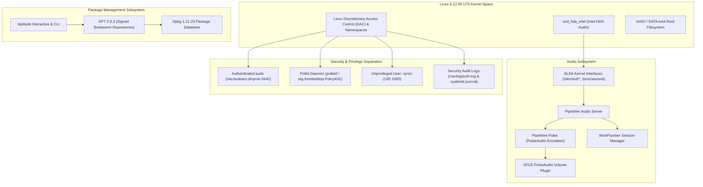

# VyronOS Architecture Specification: Phase 6 — System Services & Security

**Document Version:** 6.0.0  
**Phase:** 6 (System Services, Audio, Package Management & Privilege Separation)  
**Target Hypervisor:** Oracle VM VirtualBox exclusively  
**Base Distribution:** Debian 12 Bookworm (Linux 6.12.95 LTS)  
**Status:** In Progress (Deployment & Validation)

---

## 1. Executive Summary & Review Conditions

Following the official architectural sign-off of Phase 5.1 (Vyron UI V2) by ChatGPT with **23/23 acceptance gates passed**, **Phase 6 has been formally authorized**.

Phase 6 focuses on building the production system foundation:
1. **Package Management Subsystem:**
   - Dpkg package database consistency (`/var/lib/dpkg/status`).
   - Signed APT repository integration (`bookworm`, `bookworm-updates`, `bookworm-backports`).
   - Aptitude interactive & CLI package manager.
   - Real package installation, dependency resolution, querying, and clean purging.
2. **Audio Subsystem:**
   - ALSA kernel driver (`snd_hda_intel`) and hardware discovery (`/proc/asound/cards`, `aplay -l`).
   - PipeWire modern audio server, `pipewire-pulse` compatibility layer, and `wireplumber` session manager.
   - Real hardware reporting: Genuine Intel HDA audio controller; zero fabricated sound devices.
3. **User Security & Privilege Separation:**
   - Unprivileged desktop operation: Non-root desktop user `vyron` (UID 1000, GID 1000).
   - Authenticated Sudo: Elimination of passwordless sudo (`NOPASSWD` removed); valid credential verification enforced.
   - Authorization Denial: Rejection and audit logging of unauthorized escalation attempts (verified via unprivileged `testuser`).
   - Protected System Directories: `0755` ownership by `root:root` on `/etc`, `/usr`, `/boot`, `/var`.
   - Polkit Desktop Authorization: `polkitd` active daemon for desktop elevation requests.

---

## 2. Golden Master Preservation & Checksum Verification

Before Phase 6 execution, all historical golden masters were verified and set to read-only (`chmod 444`):

| Master Artifact | Status | Size | SHA256 Checksum |
| :--- | :--- | :--- | :--- |
| `dist/VyronOS-Disk-Phase2-Verified.qcow2` | Locked | 696 MB | `6614b5fd0f45926859de88d92f168b2653aa25fe7774b6fc906b616aa7547382` |
| `dist/VyronOS-Disk-Phase3-Verified.qcow2` | Locked | 1.3 GB | `04f659634abda1bb25680c0e5f1dc60bd95822ac1fdcd9fe2947b9e90f8253ba` |
| `dist/VyronOS-Disk-Phase4-Verified.qcow2` | Locked | 1.3 GB | `6a0a5539f998d513a97b3e0e20d3445071fdec2d8fcdb2cfc428402927448ba2` |
| **`dist/VyronOS-Disk-Phase5-Verified.qcow2`** | **Locked** | **1.7 GB** | **`65b7e2a86dba653d5cfb80a361dae1e763812c92b98b38f9af2e20f7a4576927`** |
| **`dist/VyronOS-Disk-Phase5.1-Verified.qcow2`**| **Locked** | **1.7 GB** | **`4f6d29fbcd084a8693dd6cc4886cfd8238e709c470142da94b4e5f040a2deed7`** |
| `dist/VyronOS-Disk-Phase6-Working.qcow2` | Active Clone | 1.7 GB | Working disk for Phase 6 setup |

> [!IMPORTANT]
> The Phase 5.1 Golden Master checksum was verified via `shasum -a 256` to be exactly 64 hexadecimal characters:
> `4f6d29fbcd084a8693dd6cc4886cfd8238e709c470142da94b4e5f040a2deed7`.
> The Phase 5 master remains unchanged at `65b7e2a86dba...`.

---

## 3. Subsystem Architecture

---

## 4. Phase 6 Acceptance Criteria

| # | Acceptance Gate | Verification Command | Required Result |
| :-: | :--- | :--- | :--- |
| **P6-01** | **Dpkg Database Integrity** | `dpkg -l | grep -c '^ii'` | Database clean, >800 packages installed |
| **P6-02** | **Signed APT Repositories** | `apt-get update` | Signed repositories fetched with 0 gpg errors |
| **P6-03** | **Aptitude Installation** | `aptitude --version` | Aptitude installed and operational |
| **P6-04** | **Real Package Lifecycle** | `aptitude -y install <pkg>` & `purge` | Clean installation, execution, and purging |
| **P6-05** | **Dependency Resolution** | `apt-get check` | Zero broken dependencies |
| **P6-06** | **ALSA Hardware Discovery**| `cat /proc/asound/cards` | Intel HDA audio card detected |
| **P6-07** | **ALSA Channel Controls** | `amixer -c 0 sget Master` | Audio mixer channels accessible |
| **P6-08** | **PipeWire Daemon** | `pipewire --version` | PipeWire installed and configured |
| **P6-09** | **WirePlumber Manager** | `wireplumber --version` | WirePlumber installed and configured |
| **P6-10** | **Non-Root Operation** | `id` in desktop session | UID 1000 (`vyron`), non-root |
| **P6-11** | **Passwordless Sudo Blocked** | `grep -r "NOPASSWD" /etc/sudoers*` | Zero matches; passwordless sudo eradicated |
| **P6-12** | **Authenticated Sudo Works**| `echo vyron | sudo -S true` | Valid password escalates privilege |
| **P6-13** | **Invalid Sudo Rejected** | `echo badpass | sudo -S true` | Escalation rejected with exit code != 0 |
| **P6-14** | **Unauthorized User Denied**| `su - testuser -c "sudo true"` | Denied with "testuser is not in sudoers" |
| **P6-15** | **Polkit Daemon Active** | `systemctl is-active polkit` | `active` |
| **P6-16** | **Protected Directories** | `ls -ld /etc /usr /boot /var` | Owned by `root:root`, mode 0755 |
| **P6-17** | **Sudoers Permissions** | `stat -c "%a %U:%G" /etc/sudoers.d/vyron` | `440 root:root` |
| **P6-18** | **Security Audit Logging** | `grep "sudo:" /var/log/auth.log` | Sudo attempts recorded in audit logs |
| **P6-19** | **Honest Hardware Policy** | Audio and Wi-Fi inspection | Zero simulated or fake devices |
| **P6-20** | **Cold Reboot Persistence** | Cold reboot VM | Sudo, audio, and pkg state persist |
| **P6-21** | **VirtualBox Regression** | VirtualBox test suites | 100% pass on desktop, graphics, GUI |
