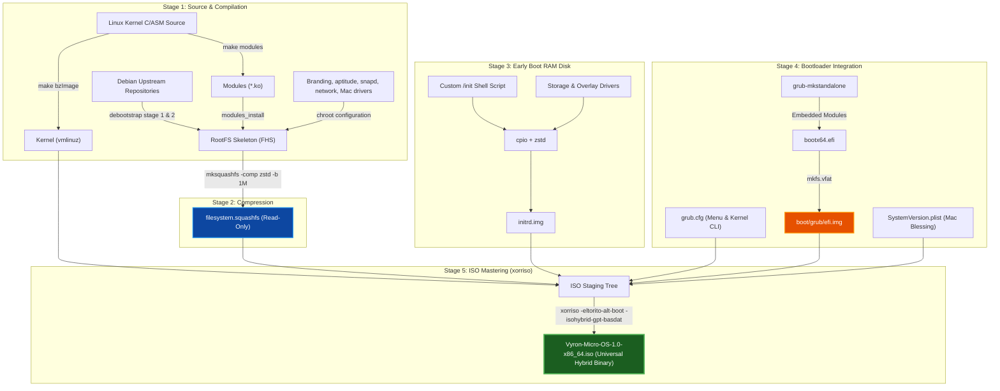

# How Source Code is Packaged into an ISO Binary: The Complete Engineering Pipeline

**Project:** VYRON Micro-OS  
**Author:** SREEHARAN  
**Scope:** Source to ISO Binary Packaging Pipeline Specification  
**Target Hardware:** Apple Mac (Intel x86_64 & Apple Silicon ARM64 / UEFI)  

---

## 1. Executive Summary & Engineering Architecture

The creation of a standalone, bootable Operating System installation or live image represents the complete traversal of the systems software stack: **from human-readable source code (C/Assembly) down to a boot-firmware-compliant, byte-aligned hybrid optical/block binary (ISO9660 / MBR / GPT)**.

### The Five Core Abstraction Transitions

```
[ C / Assembly Kernel & Subsystem Source ]
                     │  (GCC / Kbuild / Make)
                     ▼
[ ELF Binaries & Drivers ] (vmlinux, bzImage, *.ko, Shared Objects, Coreutils)
                     │  (Debootstrap / FHS Layout / RootFS Tree)
                     ▼
[ Canonical Root Filesystem Tree ] (/bin, /etc, /lib, /usr, /var)
                     │  (SquashFS Block-Level Compression: Zstandard Level 19)
                     ▼
[ Compressed Read-Only Root Image ] (filesystem.squashfs)
                     │  (Initramfs Early Boot + OverlayFS RAM Union Mount)
                     ▼
[ Ephemeral Execution Environment ] (RAM tmpfs upperdir + SquashFS lowerdir)
                     │  (Xorriso ISO Mastering + Dual El Torito + Isohybrid Injection)
                     ▼
[ Universal Hybrid ISO Binary ] (Simultaneous CD-ROM ISO9660 + USB MBR/GPT)
```

---

## 2. Stage 1: Source Code to Binaries & Root Filesystem Creation

### 2.1 Compiling the Custom Linux Kernel
The kernel is the hardware abstraction interface. In a micro-OS like **VYRON**, general-purpose distribution bloat is eliminated by pruning unneeded drivers (legacy parallel ports, enterprise fibre-channel, obscure filesystems) while hardcoding critical early-boot capabilities directly into the kernel binary (`=y`) rather than as loadable kernel modules (`=m`).

#### Critical Kernel Configuration Flags (`.config`):
```ini
# Crucial Built-in Drivers (Must be =y for Live Boot without complex initramfs dependencies)
CONFIG_BLK_DEV_INITRD=y        # Enable initial RAM disk support
CONFIG_RD_ZSTD=y               # Enable Zstandard decompressor for initramfs
CONFIG_SQUASHFS=y              # Built-in SquashFS driver
CONFIG_SQUASHFS_ZSTD=y         # Support ZSTD decompression inside SquashFS
CONFIG_OVERLAY_FS=y            # OverlayFS for writeable live filesystem
CONFIG_BLK_DEV_LOOP=y          # Loopback block device support (mounts squashfs)
CONFIG_ISO9660_FS=y            # ISO9660 optical filesystem support
CONFIG_EFI_STUB=y              # Kernel can be booted directly by UEFI firmware
```

#### Anatomical Anatomy of `bzImage`:
A `bzImage` (Big zImage) is not a raw ELF file; it is a dual-mode hybrid payload:
1. **Real-Mode Setup Code (First ~512 to 2048 bytes):** Adheres to the Linux Boot Protocol. It contains the boot sector header, memory layout parameters, and 16-bit transition code executed by BIOS/CSM.
2. **Protected/Long-Mode Payload (`piggy.o`):** Contains the actual kernel payload (`vmlinux.bin`) compressed using ZSTD/XZ, wrapped inside an uncompressed extraction stub that sets up page tables, switches the CPU into 64-bit Long Mode, uncompresses the kernel into high RAM, and jumps to `startup_64`.

---

### 2.2 Root Filesystem Creation: Userland Bootstrapping
Rather than manually compiling 5,000 GNU packages from scratch, modern OS engineering employs a deterministic bootstrap tool (`debootstrap`) to generate a clean, unpolluted FHS (Filesystem Hierarchy Standard) root directory.

#### Multi-Stage Debootstrap Execution:
```bash
# Stage 1: Download and unpack minimal packages into target folder (Host Environment)
debootstrap --init-check --arch=amd64 --variant=minbase \
  --foreign bookworm /target/vyron-rootfs http://deb.debian.org/debian/

# Stage 2: Chroot into target and execute maintainer package configurations (Target Environment)
chroot /target/vyron-rootfs /debootstrap/debootstrap --second-stage
```

#### Essential Filesystem Architecture:
Within `/target/vyron-rootfs`, the essential directory skeleton is finalized:
- `/bin`, `/sbin` -> Symlinked to `/usr/bin` and `/usr/sbin` (UsrMerge standard).
- `/lib`, `/lib64` -> Core shared libraries (`libc.so.6`, dynamic linker `ld-linux-x86-64.so.2`).
- `/etc` -> System configuration (`fstab`, `network/interfaces`, `passwd`, `shadow`).
- `/dev`, `/proc`, `/sys`, `/run` -> Virtual file system mount points populated at runtime.

---

### 2.3 Installing Aptitude, Snapd, Networking & System Branding

Within the active `chroot` jail:
```bash
# Enter the rootfs jail with bound pseudo-filesystems
mount --bind /dev /target/vyron-rootfs/dev
mount --bind /proc /target/vyron-rootfs/proc
mount --bind /sys /target/vyron-rootfs/sys
chroot /target/vyron-rootfs /bin/bash

# 1. Install Package Managers & Core Utilities
apt-get update
apt-get install -y --no-install-recommends \
  aptitude \
  snapd \
  systemd-sysv \
  network-manager \
  dbus

# 2. Package Manager Alias (aptitude -> apt)
cat << 'ALIAS' > /etc/profile.d/01-aptitude-alias.sh
alias apt='/usr/bin/aptitude'
alias apt-get='/usr/bin/aptitude'
export APT_CONFIG="/etc/apt/apt.conf.d/99vyron"
ALIAS
echo "alias apt='/usr/bin/aptitude'" >> /etc/bash.bashrc

# 3. Snapd Micro-OS Socket Activation Setup
systemctl enable snapd.socket
systemctl disable snapd.service
systemctl mask snapd.seeded.service

# 4. Custom OS Identity & Branding
cat << 'EOF' > /etc/os-release
NAME="VYRON"
ID="vyron"
ID_LIKE="debian"
VERSION="1.0-LTS"
PRETTY_NAME="VYRON Micro-OS v1.0"
HOME_URL="https://vyron.dev"
EOF

# Purge Package Cache to save ISO footprint
apt-get clean
rm -rf /var/lib/apt/lists/* /tmp/* /var/tmp/*
exit
```

---

## 3. Stage 2: Compression into Read-Only Root (`SquashFS`)

A raw extracted root filesystem occupies 1.5 GB to 4 GB. Distributing this uncompressed is prohibitive. **SquashFS** is a compressed, read-only block filesystem implemented directly in the Linux kernel.

### 3.1 SquashFS Architecture & Internal Mechanisms
Unlike TAR or GZ stream archives, SquashFS enables **O(1) random block access**:
- Files are divided into discrete blocks (typically 128 KB to 1 MB).
- Each block is compressed independently.
- An **inode and block lookup table** maintains exact byte offsets of compressed blocks.
- When the kernel accesses `/usr/bin/aptitude`, it decodes only the specific blocks containing that binary into the kernel Page Cache, leaving the rest of the disk compressed.

### 3.2 Compression Algorithm Comparison
| Algorithm | Compression Ratio | Compression Speed | Decompression Speed | RAM Footprint | Suitability for VYRON |
|:---|:---|:---|:---|:---|:---|
| **ZSTD (Level 19)** | **High (~68% reduction)** | **Fast / Multi-threaded** | **Ultra-Fast (~2.5 GB/s)** | **Low** | **Optimal (Near XZ ratio, 4x faster boot)** |
| **XZ (LZMA2)** | Highest (~72% reduction) | Extremely Slow | Slow (~350 MB/s) | High | Minimal payload size, high boot latency |
| **GZIP (DEFLATE)** | Medium (~55% reduction) | Moderate | Moderate (~600 MB/s) | Ultra-Low | Legacy compatibility only |

### 3.3 Generating `filesystem.squashfs`
```bash
mksquashfs /target/vyron-rootfs /target/iso_build/live/filesystem.squashfs \
  -comp zstd \
  -Xcompression-level 19 \
  -b 1048576 \
  -noappend \
  -wildcards \
  -e "boot/*" \
  -e "var/cache/apt/archives/*" \
  -e "tmp/*"
```

---

## 4. Stage 3: RAM Disk & Early Boot Initialization (`initramfs` & `OverlayFS`)

The BIOS/UEFI firmware loads only two files into memory: the kernel (`vmlinuz`) and the initial RAM disk (`initrd.img`). The kernel cannot immediately read `filesystem.squashfs` because:
1. It does not yet know which physical bus or device the boot medium is on (USB 3.0, NVMe, SATA CD-ROM).
2. The SquashFS filesystem is read-only, but Linux userland requires write access to `/run`, `/var/log`, `/tmp`, and `/etc`.

### 4.1 The Custom `/init` Early Boot Script
```bash
#!/bin/busybox sh
# /init - Early boot orchestrator for VYRON Micro-OS

# Step 1: Mount essential virtual filesystems
mount -t proc none /proc
mount -t sysfs none /sys
mount -t devtmpfs none /dev

# Step 2: Discover and mount the boot medium (by volume label)
echo "Searching for VYRON_OS boot media..."
mkdir -p /run/live/medium
BOOT_DEV=""

for dev in /dev/sr* /dev/sd* /dev/nvme*n*p*; do
    if blkid "$dev" | grep -q 'LABEL="VYRON_OS"'; then
        BOOT_DEV="$dev"
        break
    fi
done

mount -t iso9660 -o ro "$BOOT_DEV" /run/live/medium || \
mount -o ro "$BOOT_DEV" /run/live/medium

# Step 3: Loop-mount the compressed SquashFS root
mkdir -p /run/live/rofs
mount -t squashfs -o loop /run/live/medium/live/filesystem.squashfs /run/live/rofs

# Step 4: Construct the Ephemeral OverlayFS (Read-Write Union)
# Lowerdir = Read-Only SquashFS
# Upperdir = Read-Write RAM tmpfs (changes are written here)
# Workdir  = Internal OverlayFS atomic metadata index
mkdir -p /run/live/cow
mount -t tmpfs -o mode=0755 tmpfs /run/live/cow

mkdir -p /run/live/cow/upper /run/live/cow/work /run/live/merged
mount -t overlay overlay \
  -o lowerdir=/run/live/rofs,upperdir=/run/live/cow/upper,workdir=/run/live/cow/work \
  /run/live/merged

# Step 5: Pivot to Real Root via switch_root
mkdir -p /run/live/merged/run/live
mount --move /run/live /run/live/merged/run/live

umount /proc
umount /sys
umount /dev

# Atomically switch root and execute systemd PID 1
exec switch_root /run/live/merged /sbin/init
```

---

## 5. Stage 4: Bootloader Integration (UEFI & BIOS Dual Architecture)

To boot reliably on modern Apple Mac hardware and PC platforms, the ISO supports both:
1. **Legacy BIOS:** Uses Master Boot Record (MBR) and El Torito CD-ROM boot records.
2. **Modern UEFI (Intel Mac & Apple Silicon):** Reads a FAT32 filesystem looking for standard PE32+ binaries at `\EFI\BOOT\BOOTX64.EFI` and `\EFI\BOOT\BOOTAA64.EFI`.

```
                  ┌──────────────────────┐
                  │ Target Machine Boot  │
                  └──────────┬───────────┘
                             │
            ┌────────────────┴────────────────┐
            ▼                                 ▼
   [ Legacy BIOS / CSM ]                 [ Modern Mac UEFI ]
            │                                 │
   Reads LBA 0 / El Torito           Reads GPT / FAT32 ESP
   Catalog -> isolinux.bin           Partition -> efi.img
            │                        Executes: EFI/BOOT/BOOTX64.EFI
            │                        Or: System/Library/CoreServices/boot.efi
            └────────────────┬────────────────┘
                             │
                             ▼
                    [ GRUB2 Bootloader ]
                    Parses grub.cfg
                    Loads vmlinuz + initrd.img
                             │
                             ▼
                   [ Kernel Execution ]
```

### 5.1 Building the EFI System Partition (`efi.img`)
```bash
# 1. Allocate 8MB FAT image
dd if=/dev/zero of=/target/iso_build/boot/grub/efi.img bs=1M count=8
mkfs.vfat -F 12 -n "VYRON_EFI" /target/iso_build/boot/grub/efi.img

# 2. Build standalone monolithic EFI binary
grub-mkstandalone \
  --format=x86_64-efi \
  --output=/tmp/bootx64.efi \
  --locales="" \
  --fonts="" \
  "boot/grub/grub.cfg=/tmp/embedded_grub.cfg"

# 3. Populate EFI System Partition using mtools
mmd -i /target/iso_build/boot/grub/efi.img ::EFI ::EFI/BOOT
mcopy -i /target/iso_build/boot/grub/efi.img /tmp/bootx64.efi ::EFI/BOOT/BOOTX64.EFI
```

---

## 6. Stage 5: ISO Mastering & The Isohybrid Breakthrough

### 6.1 Flag-by-Flag Anatomy of the `xorriso` Command
```bash
xorriso -as mkisofs \
  -iso-level 3 \
  -full-iso9660-filenames \
  -volid "VYRON_OS" \
  -appid "VYRON Micro-OS Deployment Pipeline" \
  -publisher "VYRON Systems Group" \
  -eltorito-alt-boot \
  -e boot/grub/efi.img \
  -no-emul-boot \
  -isohybrid-gpt-basdat \
  -output vyron-os-1.0-amd64.iso \
  /target/iso_build/
```

#### Detailed Flag Breakdown:
1. `-as mkisofs`: Activates `mkisofs`/`genisoimage` CLI emulation mode within `xorriso`.
2. `-iso-level 3`: Allows files larger than 4 GB and unrestricted 31-character filenames, breaking ISO9660 Level 1 constraints.
3. `-volid "VYRON_OS"`: Specifies the Volume ID. Critical because `/init` uses `blkid -L "VYRON_OS"` to find the root medium.
4. `-eltorito-alt-boot`: Closes legacy boot record and opens descriptor for UEFI boot engine.
5. `-e boot/grub/efi.img`: Points to the FAT image containing `bootx64.efi` for UEFI systems.
6. `-no-emul-boot`: Instructs firmware not to emulate a 1.44 MB floppy disk; the boot image is loaded directly into RAM.
7. `-isohybrid-gpt-basdat`: Instructs xorriso to emit a valid GUID Partition Table (GPT) alongside the MBR, marking `boot/grub/efi.img` as an official EFI System Partition (GUID: `C12A7328-F81F-11D2-BA4B-00A0C93EC93B`).

---

### 6.2 The Isohybrid Breakthrough: Why `dd` Works on USB Drives

Standard ISO9660 and USB block devices have fundamentally incompatible geometry:
- **Optical Discs (CD/DVD):** Read in **2048-byte sectors**. The ISO standard specifies that the first 16 sectors (bytes 0 to 32,767) are completely reserved for system use. The Primary Volume Descriptor (PVD) starts at **Byte 32,768 (Sector 16)**. Optical firmware ignores LBA 0 entirely and jumps directly to Sector 16.
- **Hard Drives & USB Drives:** Read in **512-byte sectors**. BIOS firmware reads **LBA 0 (Bytes 0 to 511)** looking for a 512-byte Master Boot Record (MBR) ending in the magic signature `0x55AA`. UEFI firmware inspects **LBA 1 (Bytes 512 to 1023)** looking for the GUID Partition Table (GPT) header.

#### The Dual-Identity Binary Layout:
```
Byte 0                                                                   Byte 32,768
┌──────────────┬───────────────┬─────────────────────────────┬───────────┬───────────────┬───────────────────────┐
│ MBR Code     │ MBR Partition │ GPT Header & Partition      │ Free Space│ ISO9660 PVD   │ Live Filesystem       │
│ (isohdpfx)   │ Table (4 Ent) │ Array (LBA 1 to 33)         │ Reserved  │ (Sector 16)   │ (SquashFS + Kernels)  │
└──────────────┴───────────────┴─────────────────────────────┴───────────┴───────────────┴───────────────────────┘
▲                              ▲                                         ▲
│                              │                                         │
└─ Read by USB BIOS (LBA 0)    └─ Read by USB UEFI (LBA 1)               └─ Read by CD-ROM (Sector 16)
```

**How Isohybrid Exploits This Architecture:**
1. Because ISO9660 leaves the first 32,768 bytes untouched, `xorriso` injects:
   - At byte 0: Standard x86 assembly MBR boot code (`isohdpfx.bin`).
   - At byte 446: A standard MBR partition table with Partition 1 spanning the disk image, and Partition 2 pointing to the EFI image.
   - At byte 512 (LBA 1): A fully valid GPT header.
2. **When written to a USB drive (`dd if=vyron.iso of=/dev/sdX`):**
   - The BIOS or UEFI motherboard reads LBA 0 or LBA 1 as if it were a physical hard drive. It detects standard partition boundaries and executes either the MBR code or loads `\EFI\BOOT\BOOTX64.EFI` from Partition 2.
3. **When burned to an optical CD/DVD:**
   - The optical drive ignores bytes 0–32,767. It immediately reads Sector 16, finds the standard ISO9660 PVD, locates the El Torito boot catalog, and boots seamlessly.

---

## 7. Master System Flowchart



---

## 8. Technical Architecture Q&A: Deep System Mechanics

#### Q1: Why can't we simply copy the rootfs files directly onto a USB partition and boot it?
**Answer:** Without packaging into a hybrid ISO or EFI-compliant volume, motherboard UEFI firmware cannot locate `\EFI\BOOT\BOOTX64.EFI` because firmware can natively read only FAT filesystems, not ext4. Additionally, a bare filesystem is vulnerable to filesystem corruption on sudden shutdown. SquashFS is mathematically immutable, compressed, and protected by block checksums.

#### Q2: What is the difference between `chroot` and `switch_root`?
**Answer:** `chroot` only changes the root directory pointer for the calling process and leaves the RAM-based initramfs mounted, causing early-boot drivers and CPIO buffers to permanently leak system memory. `switch_root` recursively clears the old rootfs in RAM, pivots the filesystem mount to the new root, and executes `/sbin/init` as PID 1, reclaiming 100% of the early-boot RAM.

#### Q3: How does OverlayFS allow write operations on top of a read-only SquashFS?
**Answer:** OverlayFS creates a Copy-on-Write union mount combining the read-only SquashFS (`lowerdir`) with a volatile RAM-backed `tmpfs` (`upperdir`). Reads pass through to SquashFS; any file creation, package installation, or modification is intercepted and written exclusively to the RAM upperdir, keeping the underlying image pristine.
