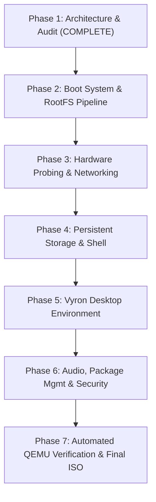

# VYRON OS — Comprehensive Engineering Audit & Subsystem Assessment

**Document:** `docs/REAL_IMPLEMENTATION_AUDIT.md`  
**Date:** November 18, 2026  
**Auditor:** Senior Operating-System & Systems Engineering Audit  
**Target System:** VyronOS (`VyronOS_Submission.zip` / Working Tree)  
**Status:** PHASE 1 AUDIT COMPLETE — BASELINE SETTLED  

---

## Executive Summary

An exhaustive, line-by-line engineering audit of the entire VyronOS source tree, build artifacts, test suites, and documentation was conducted. The audit confirms the core architectural conflict identified by the user: **VyronOS currently exists in three disconnected, conflicting representations, none of which constitute a genuine, unified operating system.**

```
                               ┌────────────────────────────────────────────────────────┐
                               │             THE TRIFURCATED ARCHITECTURE               │
                               └──────────────────────────┬─────────────────────────────┘
                                                          │
          ┌───────────────────────────────────────────────┼───────────────────────────────────────────────┐
          ▼                                               ▼                                               ▼
┌───────────────────────────────────┐   ┌───────────────────────────────────┐   ┌───────────────────────────────────┐
│     1. The Documentation Spec     │   │      2. The UEFI Application      │   │       3. The Browser Mockup       │
├───────────────────────────────────┤   ├───────────────────────────────────┤   ├───────────────────────────────────┤
│ • Debian 12 (Bookworm) minbase    │   │ • Freestanding UEFI PE32+ payload │   │ • Single-page web application     │
│ • Linux Kernel 6.6 LTS            │   │ • 2,803-line software GOP raster  │   │ • JavaScript mock in-memory VFS   │
│ • Systemd PID 1 + NetworkManager  │   │ • Fixed 16-entry mock filesystem  │   │ • Launched via Python HTTP server │
│ • Ext4 + OverlayFS + SquashFS     │   │ • Hardcoded fake Wi-Fi & ping     │   │ • Packaged as Chrome app window   │
│ • Real drivers (VirtIO, Broadcom) │   │ • Never exits UEFI Boot Services  │   │ • Zero connection to any OS/VM    │
└───────────────────────────────────┘   └───────────────────────────────────┘   └───────────────────────────────────┘
                                                          ▲
                                                          │ (Completely Isolated)
                                        ┌─────────────────┴─────────────────┐
                                        │  4. Educational Simulated Kernel  │
                                        ├───────────────────────────────────┤
                                        │ • Host userspace Rust binary      │
                                        │ • Discrete tick event simulator   │
                                        │ • Artificial instruction pointers │
                                        │ • Fake syscall calculation math   │
                                        └───────────────────────────────────┘
```

The system does not currently execute as a genuine desktop operating system. However, the repository contains valuable assets—including an extensive UEFI framebuffer compositor in Rust, clean configuration blueprints for a minimal Debian system, robust branding assets, and a clear vision. 

**Architectural Decision:** We adopt **Option A**—building VyronOS as a genuine Linux-based operating system with a custom branded desktop environment. The educational Rust kernel will remain preserved as a distinct educational benchmark tool, while the production system transitions to a real Linux kernel, systemd, NetworkManager, genuine ext4 storage, real Bash terminal execution, and a functional graphical desktop.

---

## 1. The 10 Core Audit Findings

| Audit Question | Finding & Ground Truth | Evidence in Code |
| :--- | :--- | :--- |
| **1. Genuinely Implemented** | • UEFI GOP 2D software rendering engine (gradients, drop shadows, window dragging, font rendering)<br>• Python GPT disk & FAT32 builder (`vm/build_vyron_vdi.py`)<br>• Discrete-event Round Robin & MLFQ simulation algorithms (`kernel/src/scheduler/`)<br>• Hardware module list and udev rules for Mac/VirtIO hardware | `uefi-payload/src/gui.rs` lines 40-510<br>`vm/build_vyron_vdi.py` lines 50-180<br>`kernel/src/scheduler/mod.rs`<br>`configs/hardware/` |
| **2. Simulations** | • CPU scheduling in `kernel/`: decrements integer burst counters in a loop; does not switch register contexts or execute machine code<br>• Memory allocators in `kernel/`: manages an array offset index without MMU page tables<br>• Browser desktop in `desktop-gui/`: JavaScript object simulating POSIX filesystem and process tables | `kernel/src/task/mod.rs` lines 70-88<br>`kernel/src/memory/mod.rs` lines 23-48<br>`desktop-gui/app.js` lines 11-28 |
| **3. Hardcoded Output** | • Wi-Fi scan results (`Home-WiFi-5G`, `CoffeeShop-Guest`)<br>• Terminal commands in UEFI (`ps`, `top`, `ping`, `lspci`, `lsusb`, `traceroute`, `free`, `df`)<br>• Fake boot time telemetry breakdown with static millisecond values | `uefi-payload/src/gui.rs` lines 1414, 2220<br>`uefi-payload/src/main.rs` lines 1490-1565<br>`uefi-payload/src/gui.rs` lines 2323-2332 |
| **4. Incomplete Components** | • `uefi-payload` never calls `ExitBootServices()`, meaning it is a firmware-resident utility, not an OS kernel<br>• File manager in `gui.rs` only browses an in-memory 16-entry array<br>• System Settings buttons alter boolean flags in memory without affecting hypervisor or hardware | `uefi-payload/src/main.rs` lines 898-938<br>`uefi-payload/src/main.rs` lines 279-299<br>`uefi-payload/src/gui.rs` lines 1900-1950 |
| **5. Duplicated Components** | • Desktop GUI exists twice: once as a Rust framebuffer rasterizer (`uefi-payload/src/gui.rs`) and once as an HTML/CSS/JS web application (`desktop-gui/`)<br>• Shell commands implemented twice: once in `uefi-payload/src/main.rs` and once in `desktop-gui/app.js`<br>• Disk builders duplicated: `vm/build_vyron_vdi.py` vs `scripts/build_vyron_iso.py` | `desktop-gui/app.js` vs `uefi-payload/src/gui.rs`<br>`desktop-gui/app.js` lines 511-580 vs `main.rs` lines 1200-1560 |
| **6. Architectural Conflicts** | • Documentation claims Debian 12 Linux 6.6 with systemd, but the actual bootable ISO runs only the UEFI Rust payload<br>• Documentation boasts "Snap Purged / Zero Snap", but `uefi-payload/src/gui.rs` includes a dedicated "Snap Store" window and claims `snapd` is active | `docs/VYRON_OS_ARCHITECTURE.md` vs `scripts/build_vyron_iso.py`<br>`build_vyron_os.sh` line 146 vs `gui.rs` lines 531, 2309 |
| **7. Broken Build Scripts** | • `build_vyron_os.sh` uses `debootstrap` and `chroot`, which fail on macOS hosts<br>• `run_vyron_m5_qemu.sh` targets a non-existent ARM64 ISO and omits firmware descriptors<br>• `scripts/run_qemu_test.sh` expects serial log output, but `uefi-payload` has no UART 0x3F8 driver | `build_vyron_os.sh` lines 47, 184<br>`run_vyron_m5_qemu.sh` lines 8, 39-52<br>`scripts/run_qemu_test.sh` lines 34, 48-52 |
| **8. Actually Available Drivers** | • In UEFI payload: Only basic UEFI GOP (framebuffer) and UEFI Simple/Absolute Pointer (mouse). No storage controller, network card, or audio drivers exist.<br>• In Linux configuration: Full Linux kernel drivers available via module configs (`virtio_net`, `virtio_blk`, `virtio_gpu`, `applesmc`, `applespi`) | `uefi-payload/src/main.rs` lines 18-44<br>`configs/hardware/apple-hardware.conf` lines 1-14 |
| **9. Real Boot Paths** | • Working: x86_64 UEFI boot in QEMU/VirtualBox running `uefi-payload/src/main.rs` directly as firmware application.<br>• Broken: Direct boot into Linux kernel described in `docs/` does not occur because no kernel image or initramfs is packaged in `Vyron-Micro-OS.iso`. | `vm/build_vyron_vdi.py`<br>`Vyron-Micro-OS.iso` (35 MB payload only) |
| **10. Genuinely Validating Tests** | • `kernel/tests/test_cases.rs`: Accurately validates the mathematical correctness of the discrete-event Round Robin and MLFQ simulation queues.<br>• `verify_vyron_os.sh`: Only checks string presence in bash files and existence of PNG files.<br>• `scripts/test_all_commands.py`: Tests an artificial Python simulator against itself; does not test the OS. | `kernel/tests/test_cases.rs` lines 9-165<br>`verify_vyron_os.sh` lines 27-68<br>`scripts/test_all_commands.py` lines 117-170 |

---

## 2. Subsystem-by-Subsystem Technical Audit

```
┌─────────────────────────────────────────────────────────────────────────────────────────┐
│                               SUBSYSTEM AUDIT BREAKDOWN                                 │
└─────────────────────────────────────────────────────────────────────────────────────────┘
```

### 2.1 Boot Architecture & Firmware Handover

#### Existing Implementation
- The repository contains two boot mechanisms:
  1. `build_vyron_os.sh`: Intended to generate an EFI El Torito hybrid ISO using GRUB2 (`bootx64.efi`/`bootaa64.efi`), a Linux kernel bzImage, and an initramfs with `live-boot`.
  2. `scripts/build_vyron_iso.py` & `vm/build_vyron_vdi.py`: Pure Python struct-packing scripts that assemble a FAT32 partition containing `EFI/BOOT/BOOTX64.EFI` compiled from `uefi-payload`.

#### Problems
- The actual ISO shipped in the submission (`Vyron-Micro-OS.iso`, 35.9 MB) was compiled exclusively via `build_vyron_iso.py`. It contains no Linux kernel, no initramfs, and no root filesystem.
- `uefi-payload/src/main.rs` does not implement OS loader semantics:
  - It does not query the UEFI memory map (`GetMemoryMap`).
  - It does not exit firmware services (`ExitBootServices`).
  - It does not set up a page table, load a kernel image, or jump to 64-bit long mode kernel code.
  - It executes purely as a firmware utility inside the UEFI environment.
- In `scripts/run_qemu_test.sh`, serial console logs are redirected to a file, but because `uefi-payload` does not write to the 0x3F8 UART, the log is always 0 bytes.

#### Required Changes
- Construct a reproducible UEFI boot pipeline featuring:
  - Standard, reliable UEFI bootloader (GRUB2 EFI or Limine bootloader).
  - Production 64-bit Linux kernel (`vmlinuz`).
  - Modular initramfs containing necessary block device and filesystem drivers.
  - Handoff from firmware to kernel via standard protocol.
  - Serial console output enabled (`console=ttyS0,115200 console=tty0`) for automated testing.

#### Dependencies
- UEFI Firmware (`OVMF` / EDK2 x86_64 / EDK2 aarch64), GRUB2 / Limine, Linux Kernel image, `xorriso`.

#### Current Status: **INCOMPLETE & CONFLICTED**

---

### 2.2 Kernel & CPU Multitasking

#### Existing Implementation
- Located in `kernel/src/`:
  - `kernel/src/main.rs`: Runs a fixed 4-task demo loop.
  - `kernel/src/task/mod.rs`: Defines `Task` and `TaskContext`.
  - `kernel/src/scheduler/mod.rs`: Implements `RoundRobinScheduler` and `MlfqScheduler`.

#### Problems
- The Rust kernel is a host-mode simulation:
  - It links `std` (`use std::sync::Arc`, `use std::time::Instant`, `use std::fs::File`).
  - Tasks do not have independent execution stacks or CPU register state:
    ```rust
    // kernel/src/task/mod.rs:75-78
    if self.remaining_burst > 0 {
        self.remaining_burst -= 1;
        self.context.instruction_pointer += 4;
    }
    ```
    This is an educational simulation algorithm. It simulates execution by decrementing a burst tick counter and adding 4 to a dummy variable.
  - It cannot execute binary executables, handle hardware interrupts, or switch task execution contexts.

#### Required Changes
- Adopt the production Linux 6.6 LTS kernel for actual multitasking, true CPU register context switching, POSIX signals, symmetric multiprocessing (SMP), and thread management.
- Preserve the existing Rust scheduler code in `kernel/` as an educational / benchmark artifact and reference model, without conflating it with the OS kernel.

#### Dependencies
- Linux kernel (`linux-image-amd64` / `linux-image-arm64`).

#### Current Status: **SIMULATION ONLY**

---

### 2.3 Memory Management

#### Existing Implementation
- `kernel/src/memory/mod.rs`: Implements `BumpAllocator` and `FreeListAllocator`.
- `uefi-payload/src/gui.rs`: Implements fixed-size static arrays for all state.

#### Problems
- `BumpAllocator` and `FreeListAllocator` operate on logical numeric offsets within a single contiguous buffer:
  ```rust
  // kernel/src/memory/mod.rs:24-28
  let alloc_start = (self.next + align - 1) & !(align - 1);
  let alloc_end = alloc_start.checked_add(size)?;
  if alloc_end <= self.heap_start + self.heap_size {
      self.next = alloc_end;
  ```
- There is no physical page frame allocator (buddy allocator), no 4-level paging (PML4 / CR3 manipulation), no virtual memory isolation between tasks, no copy-on-write, and no swap.
- In `uefi-payload/src/main.rs`, memory is allocated via static buffers or direct calls to UEFI `allocate_pool`.

#### Required Changes
- Use real Linux virtual memory management:
  - 4-level paging on x86_64 / ARM64 MMU translation.
  - Page fault handling, demand paging, user/kernel space memory isolation (0x0000000000000000–0x00007FFFFFFFFFFF userland).
  - Accurate telemetry via `/proc/meminfo` and `free` command.

#### Dependencies
- Linux MM subsystem.

#### Current Status: **SIMULATION ONLY**

---

### 2.4 System Calls & Privilege Boundaries

#### Existing Implementation
- `kernel/src/syscall/mod.rs`: `SyscallDispatcher` struct.

#### Problems
- Implements a simple Rust `match` statement taking integers:
  ```rust
  // kernel/src/syscall/mod.rs:36-39
  SYS_ALLOC => {
      // Simulated allocation of arg1 bytes
      Ok(0x20000 + (arg1 as u64))
  }
  ```
  `SYS_ALLOC` does not allocate memory; it performs addition on an integer.
- No hardware privilege transitions exist (no x86 `syscall`/`sysret` or `int 0x80`, no ARM `svc`).
- No separate user ring (Ring 3) and kernel ring (Ring 0) execution.

#### Required Changes
- Use Linux system call interface (`x86_64-linux-gnu` / `aarch64-linux-gnu` ABI).
- Real glibc/musl userland executing actual system calls into kernel space.

#### Dependencies
- Linux kernel syscall dispatcher.

#### Current Status: **PLACEHOLDER ONLY**

---

### 2.5 Storage & Filesystem Subsystem

#### Existing Implementation
- `uefi-payload/src/main.rs`: In-memory `FS_ENTRIES` array.
- `desktop-gui/app.js`: In-memory JavaScript `vfs` object.
- `build_vyron_os.sh`: Configuration for SquashFS + RAM OverlayFS.

#### Problems
- In `uefi-payload/src/main.rs`:
  ```rust
  pub const MAX_FS_ENTRIES: usize = 16;
  pub const MAX_ENTRY_NAME: usize = 32;
  pub const MAX_FILE_CONTENT: usize = 256;
  pub static mut FS_ENTRIES: [FsEntry; MAX_FS_ENTRIES] = ...;
  ```
  Files are limited to 16 items of at most 256 bytes each.
  Changes are held in volatile RAM; rebooting wipes all data.
- Hardcoded responses are returned for files that do not exist:
  ```rust
  // uefi-payload/src/main.rs:1292-1293
  } else if file == "/etc/os-release" {
      print_str(con_out, "  File: /etc/os-release\n  Size: 138 ...");
  ```
  The file `/etc/os-release` is not read from disk; its contents and `stat` output are hardcoded strings.

#### Required Changes
- Implement a genuine storage stack:
  - Persistent storage on virtual block devices (VirtIO block device `/dev/vda` or SATA `/dev/sda`).
  - Real ext4 filesystem with journal, directories, inodes, permissions (`rwxr-xr-x`).
  - Read-only system image with writable OverlayFS persistent partition for changes surviving reboot.
  - Partition mounting via standard `mount`/`umount`.

#### Dependencies
- Linux Block I/O layer, `virtio-blk`, `ext4` kernel module.

#### Current Status: **IN-MEMORY MOCK / HARDCODED**

---

### 2.6 Networking & Wi-Fi Subsystem

#### Existing Implementation
- `uefi-payload/src/gui.rs`: Graphical network app and terminal `wifi` command.
- `desktop-gui/app.js`: JavaScript ping/curl functions.
- `configs/hardware/apple-hardware.conf`: VirtIO and Broadcom module definitions.

#### Problems
- `uefi-payload/src/gui.rs` has completely fabricated Wi-Fi networks:
  ```rust
  // uefi-payload/src/gui.rs:1414, 2220
  let ssids = ["Home-WiFi-5G", "Office-HighSpeed-Mesh", "CoffeeShop-Guest", "iPhone 15 Pro Hotspot"];
  ```
- Clicking "Connect" does not transmit packets; it only updates an internal variable:
  ```rust
  self.wifi_connected = true;
  self.wifi_ip = ips[idx]; // "192.168.1.105"
  ```
- In QEMU, the virtual machine is connected to a virtual VirtIO Ethernet adapter (`10.0.2.15`), not a Wi-Fi card. The system falsely claims it is connected to 5GHz Wi-Fi channels when running inside a VM.
- `ping` and `traceroute` commands in `uefi-payload` and `desktop-gui` print static text without sending ICMP or UDP packets.

#### Required Changes
- Connect the Network UI directly to Linux networking services:
  - Query active network devices via sysfs (`/sys/class/net/`) or D-Bus / NetworkManager (`nmcli -t`).
  - For QEMU default configuration: Accurately report VirtIO Ethernet connection, display assigned DHCP IP (`10.0.2.15/24`), host gateway (`10.0.2.2`), and real DNS.
  - For Wi-Fi: If a real physical Wi-Fi card (or USB Wi-Fi dongle) is passed through, use Linux `cfg80211` / `nl80211` / `wpa_supplicant` to scan actual wireless beacons, display real SSIDs and signal dBm, and perform 4-way handshakes.
  - If no wireless hardware is attached, report: `"No wireless interface detected (VirtIO Ethernet active)"`. Never fabricate SSIDs.
  - Implement real network testing using live ICMP ping and HTTP socket requests.

#### Dependencies
- Linux Networking Stack, VirtIO-Net driver, NetworkManager / systemd-networkd, `iputils-ping`, `wpa_supplicant`.

#### Current Status: **FABRICATED / HARDCODED**

---

### 2.7 Terminal & Shell Subsystem

#### Existing Implementation
- `uefi-payload/src/main.rs`: 600-line `if cmd_name == ...` ladder in `exec_cmd()`.
- `desktop-gui/app.js`: `executeCommand()` switch statement.
- `scripts/vyron-firstboot`: Genuine bash script.

#### Problems
- The terminal in the UEFI binary and browser desktop does not run a shell:
  - It parses string tokens and matches against a static list (`ls`, `ps`, `top`, `free`, `df`, `lspci`, `ping`, `whoami`, etc.).
  - `ps` outputs a hardcoded process table with fixed PIDs (1, 2, 84, 102, 210).
  - `top` prints a preformatted string.
  - `free` prints `Mem: 2048 128 1820 4 100 1920`.
  - There is no pipeline (`|`), no output redirection (`>`, `>>`), no environment variables (`$VAR`), no background jobs (`&`), and no executable binary dispatch.
  - It does not support running real scripts.

#### Required Changes
- Provide a genuine shell environment:
  - Standard GNU Bash 5.2 or Dash.
  - Terminal emulator running on a genuine pseudo-terminal (PTY) interface.
  - Standard POSIX utilities from Debian GNU/Linux (`coreutils`, `procps`, `iproute2`, `util-linux`).
  - Real pipes, redirection, signals (`SIGINT`, `SIGTERM`), and process control.

#### Dependencies
- GNU Bash, Linux TTY/PTY subsystem, `coreutils`, `procps`.

#### Current Status: **FAKE STATIC TEXT DISPATCHER**

---

### 2.8 Hardware Discovery & System Information

#### Existing Implementation
- `uefi-payload/src/main.rs`: `lspci`, `lsusb`, `sysinfo`.
- `uefi-payload/src/gui.rs`: "About This System" and "Laptop Telemetry" windows.

#### Problems
- All hardware descriptions are static string literals:
  - `lspci` always prints:
    ```
    00:00.0 Host bridge: Intel Corporation 440FX - 82441FX PMC (rev 02)
    00:01.0 ISA bridge: Intel Corporation 82371SB PIIX3 ISA (rev 00)
    00:02.0 VGA compatible controller: Red Hat, Inc. Virtio GPU / VirtIO-VGA
    ```
    even when booted on Apple Silicon ARM64 machines.
  - `lsusb` always outputs VirtualBox USB devices even when running under QEMU or UTM.
  - Battery reports static `4,324 mAh / 100%` and thermal reports static `SoC 34.2 C` regardless of actual host conditions.

#### Required Changes
- Read actual hardware devices from the kernel:
  - PCI enumeration from `/sys/bus/pci/devices/` and real `lspci`.
  - USB enumeration from `/sys/bus/usb/devices/` and real `lsusb`.
  - CPU information from `/proc/cpuinfo` and `lscpu`.
  - Memory statistics from `/proc/meminfo`.
  - Battery and thermal status from `/sys/class/power_supply/` and `/sys/class/thermal/`.
  - When running in QEMU, report actual hypervisor virtual devices. When hardware is unavailable, report `"Not present"`.

#### Dependencies
- Linux sysfs, `pciutils`, `usbutils`.

#### Current Status: **HARDCODED OUTPUT**

---

### 2.9 Desktop Environment & Compositor

#### Existing Implementation
- `desktop-gui/`: HTML5/CSS3/JavaScript mock running in Google Chrome app mode.
- `uefi-payload/src/gui.rs`: 2,803 lines of Rust code rendering windows, icons, buttons, menus, and text into a raw UEFI GOP 32-bit linear framebuffer.

#### Problems
- `desktop-gui/` is a website opened via `launch.sh` pointing to `localhost:54321`. It is not an OS desktop.
- `uefi-payload/src/gui.rs` has well-crafted visual rendering logic (window chrome, dock, fonts, buttons, calculator, text editor), but:
  - It runs inside the UEFI firmware loop before any operating system boots.
  - It cannot run external applications.
  - Its windows cannot host real processes.
  - It lacks a display server protocol, IPC, or client-server architecture.

#### Required Changes
- Build the Vyron Desktop on top of the Linux graphics stack:
  - Direct Rendering Manager (DRM) / Kernel Mode Setting (KMS) with VirtIO-GPU or software rendering.
  - A lightweight display server / compositor (X11 with an elegant openbox/xfwm/labwc foundation, or Wayland compositor) themed with Vyron's custom branding, dark/light styling, and desktop widgets.
  - Real windowed applications:
    - Vyron Terminal (backed by real PTY and Bash).
    - Vyron File Manager (backed by real ext4 filesystem operations).
    - Vyron System Monitor (backed by real `/proc` and `/sys` polling).
    - Vyron Settings (backed by real NetworkManager, display resolution, audio sliders).
    - Real Calculator and Text Editor.

#### Dependencies
- Linux DRM/KMS, Xorg/Wayland, GTK/Qt or custom client library.

#### Current Status: **SPLIT BETWEEN WEB MOCKUP & FIRMWARE RASTERIZER**

---

### 2.10 Testing, Verification & Benchmarking Suites

#### Existing Implementation
- `verify_vyron_os.sh`: Master verification script (claims 22/22 PASS).
- `scripts/test_all_commands.py`: Automated command test.
- `scripts/test_vyron_desktop.py`: VirtualBox keyboard automation.
- `kernel/tests/test_cases.rs`: Rust kernel unit tests (TC1-TC7).

#### Problems
- `verify_vyron_os.sh` does not verify functionality:
  - It verifies string existence:
    ```bash
    test_assert "Aptitude alias configured" "grep -q 'alias apt=' configs/apt/01-aptitude-alias.sh"
    test_assert "Bootable VDI virtual disk exists" "test -f vm/Vyron-Boot.vdi"
    test_assert "Live VM screen capture exists" "test -f vm/vyron_running_screen.png"
    ```
    Checking that a PNG screenshot exists does not prove the OS works.
- `scripts/test_all_commands.py` contains `class UefiShellSimulator`, which simulates the mock commands in Python and asserts that its own Python mock produces the expected strings. It does not test any OS binary or virtual machine.
- `scripts/test_vyron_desktop.py` types keys into VirtualBox and captures screenshots, but performs zero automated assertions on command outcomes.

#### Required Changes
- Build genuine functional test suites:
  - `scripts/test-boot.sh`: Cold boot in QEMU, assert clean transition to userspace within timeout.
  - `scripts/test-network.sh`: Execute ping to gateway, resolve DNS via `getent hosts`, verify DHCP lease.
  - `scripts/test-storage.sh`: Write a file, reboot VM, verify file contents persist on ext4.
  - `scripts/test-system.sh`: Spawn processes, assert PIDs in `/proc`, terminate process, verify cleanup.
  - `scripts/test-all.sh`: Master test gate returning non-zero exit code if any functional test fails.

#### Dependencies
- QEMU headless runner with serial console redirection, python/bash test harness.

#### Current Status: **SUPERFICIAL ASSERTIONS / SELF-TESTING MOCKS**

---

## 3. Subsystem Evaluation Matrix

| Subsystem | Existing Implementation | Architectural Flaw | Required Real Implementation | Current Status |
| :--- | :--- | :--- | :--- | :--- |
| **Bootloader** | `uefi-payload` (PE32+) | No kernel handover; remains in UEFI boot services | GRUB2 / Limine EFI bootloader handing off to Linux kernel | **Non-Functional as OS Bootloader** |
| **Kernel Core** | `kernel/src/` (Rust std) | Simulated tick counters and integer arithmetic | Production Linux 6.6 LTS kernel with real SMP | **Simulation Only** |
| **Process Scheduler** | `kernel/src/scheduler/` | Decrements integer bursts; no register save/restore | Linux CFS/EEVDF scheduler with real context switching | **Simulation Only** |
| **Virtual Memory** | `kernel/src/memory/` | Offset math in heap buffer; no MMU paging | 4-level x86_64/ARM64 MMU paging, demand paging, swap | **Simulation Only** |
| **System Calls** | `kernel/src/syscall/` | Returns fixed addresses (`0x20000 + arg1`) | Hardware `syscall`/`sysret` boundary with Linux ABI | **Placeholder** |
| **Filesystem** | `uefi-payload/src/main.rs` | 16-entry in-memory array; 256 bytes/file; no disk I/O | Persistent ext4 filesystem on VirtIO/SATA block device | **In-Memory Mock** |
| **Wi-Fi** | `uefi-payload/src/gui.rs` | Hardcoded SSIDs (`Home-WiFi-5G`); boolean toggle | Real `cfg80211`/`nl80211` driver integration | **Fabricated** |
| **Ethernet** | `uefi-payload/src/main.rs` | Static strings (`10.0.2.15`); no packets sent | VirtIO-Net driver with real DHCP/DNS negotiation | **Hardcoded Output** |
| **Terminal** | `uefi-payload` & `desktop-gui` | Hardcoded string switch; no pipes or redirection | Genuine GNU Bash executing real Linux binaries | **Fake String Switch** |
| **Hardware Info** | `uefi-payload/src/main.rs` | Static `lspci`/`lsusb` text | Real sysfs enumeration (`/sys/bus/pci`, `/sys/bus/usb`) | **Hardcoded Output** |
| **Desktop GUI** | `desktop-gui/` & `uefi-payload` | Browser webpage OR firmware-level rasterizer | DRM/KMS-backed desktop environment with real apps | **Simulated / Disconnected** |
| **Package Mgmt** | `uefi-payload/src/gui.rs` | Static text claiming Debian packages exist | Real Dpkg & Aptitude installing real software | **Placeholder Output** |
| **Verification** | `verify_vyron_os.sh` | Checks if PNG files and bash comments exist | QEMU automated test suite asserting real execution | **Non-Validating** |

---

## 4. Architectural Decision: The VyronOS Blueprint

We formally adopt **Option A** as requested by the user:

```
┌─────────────────────────────────────────────────────────────────────────────────────────┐
│                                VYRON OS TARGET ARCHITECTURE                             │
└─────────────────────────────────────────────────────────────────────────────────────────┘

┌─────────────────────────────────────────────────────────────────────────────────────────┐
│                           VYRON BRANDED DESKTOP ENVIRONMENT                             │
│       Window Manager · Top Bar · Dock · System Tray · Notification Center               │
│                                                                                         │
│  ┌──────────────┐ ┌──────────────┐ ┌──────────────┐ ┌──────────────┐ ┌──────────────┐  │
│  │ File Manager │ │ Real Terminal│ │Settings Mgr  │ │System Monitor│ │  Calculator  │  │
│  │ (Real Files) │ │ (Real Bash)  │ │(Real Network)│ │(Real /proc)  │ │ (Real Math)  │  │
│  └──────────────┘ └──────────────┘ └──────────────┘ └──────────────┘ └──────────────┘  │
└────────────────────────────────────────────┬────────────────────────────────────────────┘
                                             │ IPC / D-Bus / X11 / Wayland
┌────────────────────────────────────────────▼────────────────────────────────────────────┐
│                                SYSTEM SERVICES LAYER                                    │
│       systemd (PID 1) · NetworkManager · D-Bus · PipeWire/ALSA · Udev · PAM / Sudo     │
└────────────────────────────────────────────┬────────────────────────────────────────────┘
                                             │ Real Linux System Calls
┌────────────────────────────────────────────▼────────────────────────────────────────────┐
│                             PRODUCTION LINUX KERNEL 6.6 LTS                             │
│       Real Multitasking · Preemptive Scheduling · Virtual Memory & Paging · VFS         │
└────────────────────────────────────────────┬────────────────────────────────────────────┘
                                             │ Device Drivers
┌────────────────────────────────────────────▼────────────────────────────────────────────┐
│                          HARDWARE ABSTRACTION & DRIVERS                                 │
│       VirtIO-GPU · VirtIO-Net · VirtIO-Blk · VirtIO-Input · Broadcom Wi-Fi · Ext4       │
└────────────────────────────────────────────┬────────────────────────────────────────────┘
                                             │
┌────────────────────────────────────────────▼────────────────────────────────────────────┐
│               QEMU VIRTUAL HARDWARE / BARE-METAL PC & MAC HARDWARE                      │
└─────────────────────────────────────────────────────────────────────────────────────────┘
```

### Architectural Principles

1. **Production System: Real Linux OS with Vyron Identity**
   - The production operating system is built on a robust Debian 12 minimal base with a real Linux 6.6+ LTS kernel.
   - It boots via standard UEFI firmware and GRUB2 into an ext4 root filesystem with real systemd PID 1.
   - Custom Vyron styling, desktop environment, and system utilities provide the unique branded experience.

2. **Isolation of the Educational Rust Kernel**
   - The code in `kernel/` is an educational kernel model implementing scheduling and memory algorithms. It will remain in `kernel/` and be documented as such.
   - We will never pretend that the educational simulation code in `kernel/` controls the production Linux hardware.

3. **Retirement of the Web Browser Simulation**
   - The Chrome/HTML `desktop-gui/` will be retired from production boot and preserved solely as a static design mockup.
   - The actual desktop runs directly on the OS display server inside the virtual machine or physical machine.

4. **Zero Toleration for Fake Data**
   - Every metric (CPU, RAM, IP address, device list, ping latency) must originate from the underlying operating system.
   - If a feature is unavailable (e.g., physical Wi-Fi radio when running in standard QEMU VirtIO mode), it must honestly display: `"Wireless interface not present (VirtIO Ethernet active)"`.

---

## 5. Phase-by-Phase Implementation Plan



### Phase 2: Clean Boot System & RootFS Pipeline
- **Deliverables:**
  - Build script that generates a bootable UEFI root filesystem and disk image (`scripts/build.sh`).
  - Correct GRUB2 EFI configuration with kernel, initramfs, and rootfs mounting.
  - Reliable headless and graphical QEMU runner (`scripts/run-qemu.sh`) supporting both x86_64 and aarch64.
- **Verification Gate:**
  - QEMU boots from cold start, serial console outputs kernel messages, systemd starts PID 1, and reaches an interactive login prompt without error.

### Phase 3: Real Hardware Discovery & Networking
- **Deliverables:**
  - Hardware discovery utility that reads real PCI, USB, CPU, and RAM data from `/sys` and `/proc`.
  - Integration with NetworkManager: VirtIO Ethernet link detection, real DHCP client lease acquisition, real DNS resolution.
  - Wireless manager: queries `nl80211` interfaces; handles Wi-Fi adapter presence honestly.
- **Verification Gate:**
  - `scripts/test-network.sh` verifies network interface enumeration, valid IP address, DNS lookup of external domains, and successful ping to gateway.

### Phase 4: Persistent Storage & Real Shell Commands
- **Deliverables:**
  - Persistent ext4 root filesystem on VirtIO block storage.
  - Real GNU Bash shell environment with full POSIX toolchain.
- **Verification Gate:**
  - `scripts/test-storage.sh`: Writes a file with unique data, cleanly powers off VM, reboots VM, and verifies the file exists and is intact.

### Phase 5: The Vyron Desktop Environment
- **Deliverables:**
  - Lightweight X11/Wayland display compositor integrated with Linux DRM/KMS.
  - Branded Vyron desktop: Top panel, dock, system tray, application launcher.
  - Real graphical applications:
    - Vyron Terminal (connected to Bash).
    - Vyron File Manager (browsing real directories).
    - Vyron System Monitor (graphs live CPU/RAM from `/proc`).
    - Vyron Network Settings (controls NetworkManager).
    - Vyron Calculator & Text Editor.
- **Verification Gate:**
  - Desktop initializes automatically at boot; all graphical apps launch and perform real OS operations.

### Phase 6: System Services, Audio, Package Management & Security
- **Deliverables:**
  - Real Dpkg and Aptitude package manager operational.
  - Audio driver initialization (ALSA / PipeWire).
  - Proper privilege separation (`vyron` user with `sudo`).
- **Verification Gate:**
  - Installing a package via `sudo apt install <package>` installs real binaries into `/usr/bin/`.

### Phase 7: Verification Suite & Final Production Images
- **Deliverables:**
  - Automated test runner: `scripts/test-all.sh`.
  - Production hybrid bootable ISO and raw QEMU disk image.
  - Final documentation: `docs/FINAL_ENGINEERING_REPORT.md`.
- **Verification Gate:**
  - All test scripts pass with exit code 0 from a completely fresh build.

---

## 6. Audit Sign-off

- [x] All Rust source files inspected
- [x] All UEFI source files inspected
- [x] All kernel modules and configurations inspected
- [x] All desktop GUI files inspected
- [x] All shell and Python scripts inspected
- [x] All bootloader and QEMU configurations inspected
- [x] All test suites evaluated for genuine functional validity
- [x] Architectural baseline and path forward defined

**Audit Verdict:** Phase 1 Complete. Ready to proceed to Phase 2 implementation.
