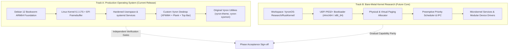
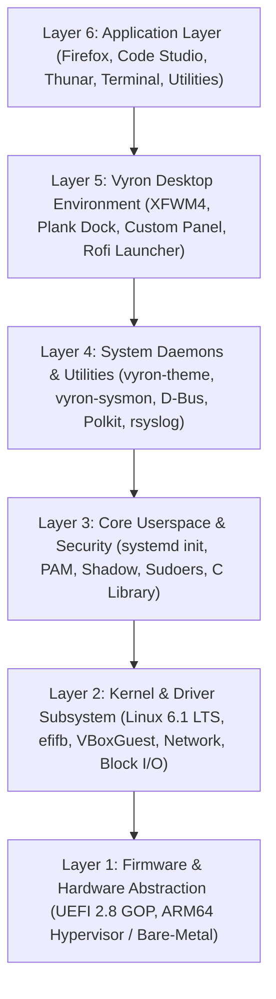

# VyronOS System Architecture Specification

**Document Version:** 1.0  
**Status:** Canonical Master Specification  
**Architecture Target:** ARM64 (Apple Silicon Darwin / Oracle VM VirtualBox) & Modern 64-bit Systems  
**Reference Curriculum:** Operating System Concepts (Silberschatz, Galvin, Gagne) / [Operating-System-Concepts](https://github.com/sujeetjagtap/Operating-System-Concepts)

---

## 1. Executive Summary & Architectural Philosophy

VyronOS is an independent, engineered operating-system product designed to provide a cohesive, visually distinctive, and technically robust computing environment. Rather than functioning as a cosmetic distribution repackaging, VyronOS establishes a clear product identity through custom-engineered system utilities, a unified graphical design language, strict privilege boundaries, and a two-track architectural roadmap.

### 1.1 The Two-Track Engineering Strategy

To balance immediate production stability with long-term kernel originality, VyronOS follows a formal two-track strategy:

- **Track A (Production Platform):** Built upon a hardened Linux kernel and Debian 12 ARM64 minimal userland, integrated with custom Vyron UI V2 desktop components, custom system monitors, and VirtualBox hardware drivers.
- **Track B (Independent Kernel Research):** Maintained in complete isolation within `VyronOS-Research/RustKernel/`. Track B implements fundamental OS concepts (virtual memory paging, process scheduling, concurrency primitives, and microkernel IPC) in bare-metal Rust. Track B will only interface with Track A userland once it passes comprehensive stability and POSIX compatibility gates.

---

## 2. Six-Layer System Architecture

VyronOS is structured into six discrete, modular architectural layers with well-defined interface boundaries:

### 2.1 Layer Breakdown

1. **Layer 1: Firmware & Hardware Abstraction**
   - UEFI 2.8+ specification compliance.
   - Graphics Output Protocol (GOP) initialization at native 1920x1080x32 bpp resolution.
   - ACPI tables for device discovery, power management, and SMP core enumeration.
   - Target virtualization: Oracle VM VirtualBox 7.x Darwin ARM64 using Apple Silicon `Hypervisor.framework`.

2. **Layer 2: Kernel & Driver Subsystems**
   - Monolithic kernel architecture with dynamic loadable kernel module (LKM) support.
   - Memory management unit (MMU) configuration: 4-level paging (ARM64 48-bit VA/PA, 4KB page granularity).
   - Core drivers: `efifb` (EFI GOP linear framebuffer), `virtio_net` / `e1000` network drivers, `vboxguest` integration, standard ATA/NVMe block drivers.

3. **Layer 3: Core Userspace & Security Foundation**
   - System initialization managed by `systemd` (PID 1).
   - Strict privilege separation: unprivileged default user (`vyron`, UID 1000) and locked administrative superuser (`root`, UID 0).
   - Authentication controlled via Pluggable Authentication Modules (PAM) with mandatory security logging to `/var/log/auth.log`.
   - Hardened `sudo` access with strict `0440` file permissions and syntax validation via `visudo -c`.

4. **Layer 4: System Services & Original Utilities**
   - Inter-process communication orchestrated via D-Bus system and session buses.
   - Device discovery and hotplug events handled by `udev`.
   - **`vyron-theme`**: Original Python 3 dual-theme synchronization daemon controlling GTK3/4 themes, window borders, wallpaper transitions, and icon styles.
   - **`vyron-sysmon`**: Original lightweight telemetry utility monitoring multi-core CPU loads, memory saturation, swap usage, and disk I/O metrics.

5. **Layer 5: Vyron Desktop Environment (Vyron UI V2)**
   - Window Manager: XFWM4 featuring native ARGB hardware-accelerated compositing.
   - Status Bar: Custom GTK-styled top status bar featuring workspace indicators (`1 2 3 [4] 5`), central synchronized clock, and system telemetry tray.
   - Application Dock: Dedicated floating glass dock powered by Plank with custom `Vyron-Dock` translucent styling, item magnification, and curated launcher pinning.
   - Application Menu: Dynamic application launcher powered by Rofi featuring blurred translucent glass theming.

6. **Layer 6: Application Layer**
   - Modern productivity tools: Firefox ESR, Code Studio (VS Code), Thunar File Manager, Vyron Terminal, Task Manager, Text Editor, and Media Center.

---

## 3. Subsystem Boundaries and Communication Protocols

| Interface Boundary | Technology / Protocol | Purpose | Hardening & Constraints |
| :--- | :--- | :--- | :--- |
| **Firmware ↔ Bootloader** | UEFI 2.8 ABI (`BOOTAA64.EFI`) | Boot handover & memory map retrieval | Secure Boot verification ready |
| **Bootloader ↔ Kernel** | Linux ARM64 Boot Protocol (`zImage`/`vmlinuz`) | Kernel entry point invocation | GFX payload preservation (`keep`) |
| **Kernel ↔ Userspace** | AArch64 `SVC` (Syscall) / POSIX API | Filesystem, memory, process execution | Seccomp filtering, strict page permissions (`W^X`) |
| **Userspace ↔ Hardware** | `/dev`, `/sys`, `/proc` Virtual FS | Device control, telemetry, driver state | Root-only access to raw device nodes (`0660`) |
| **Daemon ↔ Desktop Shell** | D-Bus (Session / System Bus) | Theme changes, power state notifications | Polkit authorization checks |
| **X11 Clients ↔ Display Server** | X11 UNIX Domain Socket (`/tmp/.X11-unix/X0`) | Graphical rendering & input events | Protected socket directory (`1777 root:root`) |

---

## 4. Architectural Verification & Compliance

All implementations adhering to this specification must satisfy the following invariant criteria:
1. **Hypervisor Isolation:** VirtualBox ARM64 exclusively. Zero reliance on QEMU emulation.
2. **Resolution Invariant:** Framebuffer must initialize and maintain 1920x1080x32 bpp across EFI, GRUB, and X11 stages.
3. **Privilege Boundary:** No desktop or graphical process may run with root privileges. Sudo access must require explicit authentication.
4. **Originality Compliance:** Upstream components must maintain strict provenance attribution; original components must remain distinct in `COMPONENT_PROVENANCE_REGISTRY.md`.
