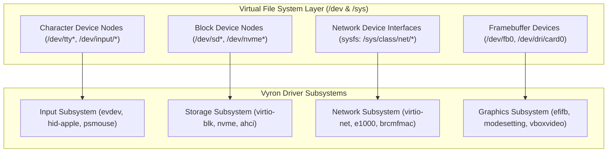
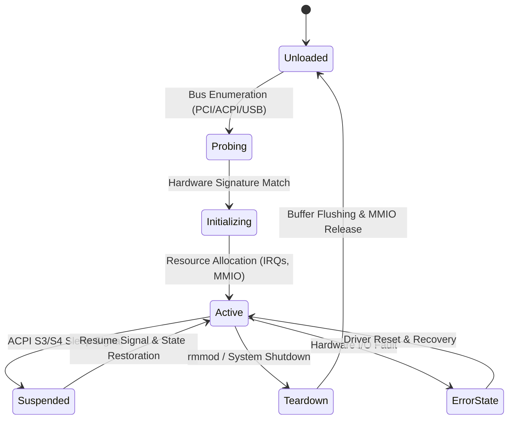

# VyronOS Driver Subsystem & Hardware Abstraction Specification

**Document Version:** 1.0  
**Status:** Canonical Driver Specification  
**Architecture Target:** VirtualBox Darwin ARM64 & Apple Silicon Hardware  
**Driver Model:** POSIX / Linux Character, Block, Network, and Framebuffer Device Drivers

---

## 1. Device Driver Model & Architecture

VyronOS organizes its device drivers into four standardized classes according to POSIX abstractions:

---

## 2. VirtualBox Darwin ARM64 Hardware Abstraction

VyronOS specifically optimizes driver bindings for the Oracle VM VirtualBox 7.x Darwin ARM64 hypervisor running on Apple Silicon:

### 2.1 Video & Display Architecture (`efifb`)
- **Driver:** Linear EFI GOP Framebuffer (`drivers/video/fbdev/efifb.c`).
- **Resolution Binding:** Configured via `VBoxInternal2/EfiGraphicsResolution="1920x1080"` and kernel cmdline parameter `video=efifb:1920x1080-32@60`.
- **Display Server Interface:** Xorg utilizes the generic `modesetting` / `fbdev` driver without proprietary binary blobs.
- **Color Format:** 32-bit ARGB (8:8:8:8) TrueColor with 7680-byte scanline pitch.

### 2.2 Storage & Mass Memory Subsystem
- **Bus Controller:** SATA AHCI (`ahci.c`) or VirtIO-Block.
- **I/O Scheduler:** Multi-queue block layer (`mq-deadline` or `none` for hypervisor NVMe passthrough), minimizing context-switch overhead.
- **Filesystem Mapping:** Persistent Rootfs mounted via UUID on `/dev/sda1` (ext4 with `noatime,errors=remount-ro`).

### 2.3 Network Interface Subsystem
- **Virtual Controller:** Intel PRO/1000 MT Desktop (82540EM) or VirtIO-Net.
- **Interface Naming:** Systemd predictable network interface names (e.g., `enx080027c17b86`).
- **Driver Module:** `e1000` / `virtio_net`.
- **Acceleration:** Checksum offloading (RX/TX) and scatter-gather I/O enabled via ethtool.

### 2.4 Human Interface Devices (HID)
- **Mouse & Pointer:** USB Absolute Pointing Device (`hid-generic` / `usbhid`). Eliminates mouse pointer capture/release latency inside VirtualBox GUI.
- **Keyboard:** Standard AT PS/2 Keyboard (`psmouse` / `atkbd`).
- **Apple Silicon Hardware Fallback:** `applespi` and `hid-apple` modules configured with `fnmode=2` (function keys as primary) for bare-metal Mac hardware.

---

## 3. Driver Lifecycle State Machine

All native and virtual drivers within VyronOS adhere to a formal five-phase lifecycle state machine:

### 3.1 Error Recovery Protocol
- In the event of a PCIe bus error or MMIO timeout, the driver initiates an in-band software reset before escalating to a kernel panic.
- Framebuffer device drivers maintain an automatic fallback to standard VGA/GOP text console mode if Xorg compositor initialization fails.

---

## 4. Security & Privilege Boundaries in Driver Access

1. **Rootless Hardware Access:** Userland applications cannot open raw block (`/dev/sda`) or physical memory (`/dev/mem`) nodes.
2. **Device File Permissions:**
   - Input event devices (`/dev/input/*`): Owned by `root:input` with `0660` permissions.
   - Video card nodes (`/dev/dri/*`): Owned by `root:render` / `root:video` with `0660` permissions.
   - Audio devices (`/dev/snd/*`): Owned by `root:audio` with `0660` permissions.
3. **Udev Rule Hardening:** Unauthenticated USB mass storage devices cannot execute auto-run payloads; `udev` mounts media with `nodev,nosuid,noexec` flags.
