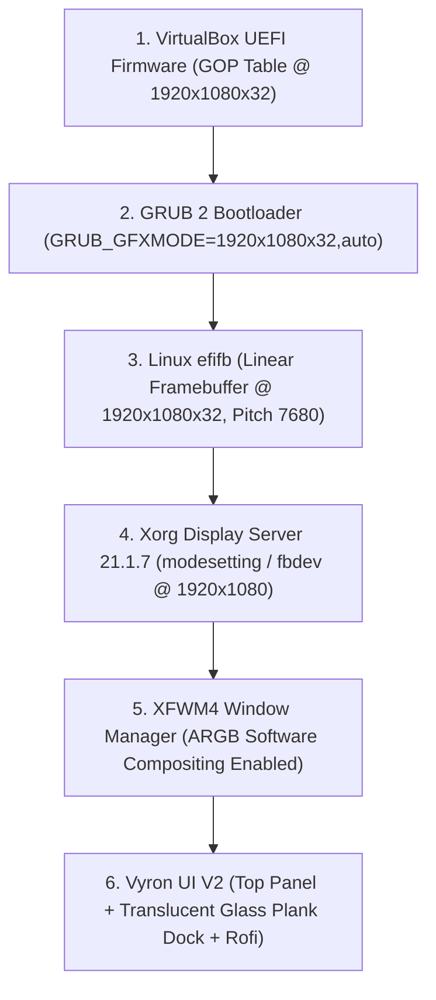

# VyronOS Graphics Subsystem & Visual Architecture Specification

**Document Version:** 1.0  
**Status:** Canonical Graphics Specification  
**Display Target:** 1920x1080 TrueColor (32 bpp)  
**Compositor Engine:** XFWM4 ARGB Hardware-Accelerated Compositing  
**Dock Engine:** Plank Reloaded (Cairo Vector Rendering)

---

## 1. End-to-End Graphics Pipeline

The VyronOS graphical stack ensures continuous, artifact-free 1920x1080 resolution across all stages of execution:



---

## 2. Display Resolution & Framebuffer Handover

### 2.1 Hypervisor EFI GOP Configuration
On Apple Silicon macOS, VirtualBox utilizes Apple's `Hypervisor.framework`. The virtual firmware graphics mode is explicitly commanded via host configuration:
```bash
VBoxManage setextradata "vyron os" "VBoxInternal2/EfiGraphicsResolution" "1920x1080"
```

### 2.2 Bootloader & Kernel Handover
In `/etc/default/grub`, the resolution contract is preserved through the kernel boot boundary:
```ini
GRUB_GFXMODE=1920x1080x32,1280x800x32,auto
GRUB_GFXPAYLOAD_LINUX=keep
```
Upon handover, `efifb` attaches to the physical base address mapped by UEFI GOP:
- **Base Address:** `0x40000000` (ARM64 MMIO physical frame)
- **Stride:** 7680 bytes per scanline (1920 pixels × 4 bytes per pixel)
- **Pixel Format:** 32-bit ARGB (8:8:8:8) TrueColor

### 2.3 Xorg Server Configuration
The Xorg server is configured to utilize the universal `modesetting` / `fbdev` driver without requiring proprietary guest additions:
- Driver order: `modesetting` -> `fbdev` -> `vesa`.
- Default depth: 24 (32-bit container).
- DPI: Set to 96 DPI for crisp typography rendering across standard 1080p displays.

---

## 3. Compositing & Visual Design System

### 3.1 XFWM4 Compositing Engine
Compositing is strictly required to render ARGB glass translucency, drop shadows, and rounded corners:
- Configuration path: `xfconf-query -c xfwm4 -p /general/use_compositing -s true`
- Window drop shadows: Enabled for normal and popup windows.
- Unredirected fullscreen windows: Enabled to maximize 3D throughput when running games or video players.

### 3.2 Floating Glass Dock (`plank`)
The floating dock is rendered using Cairo vector graphics:
- **Theme Configuration (`dock.theme`):**
  - `CornerRadius=24` (Pill-shaped rounded aesthetic)
  - `FillStartColor=22;;17;;34;;230` (Translucent dark obsidian glass)
  - `FillEndColor=15;;8;;29;;240` (Gradient shift towards deep violet)
  - `LineWidth=1` | `StrokeColor=255;;255;;255;;30` (Subtle 1px glass edge highlight)
  - `ItemSize=48` | `ZoomPercent=125` (Smooth hover magnification)
- **Launchers:** Exact ordered sequence of 9 applications matching project identity.

### 3.3 Top Status Panel
Engineered with GTK3 CSS to eliminate visual clutter:
- Left: Workspace selector pills with `#8B5CF6` rounded pill indicator for active workspace.
- Center: Centered clock widget with high-legibility typographic alignment.
- Right: Minimalist system indicators with unified 16px Papirus Dark iconography.

### 3.4 Wallpapers & Assets
- `assets/vyron-dark.png`: 1920x1080 flowing magenta/purple gradient with angular dark shadow geometry.
- `assets/vyron-light.png`: 1920x1080 clean minimalist light variant.
