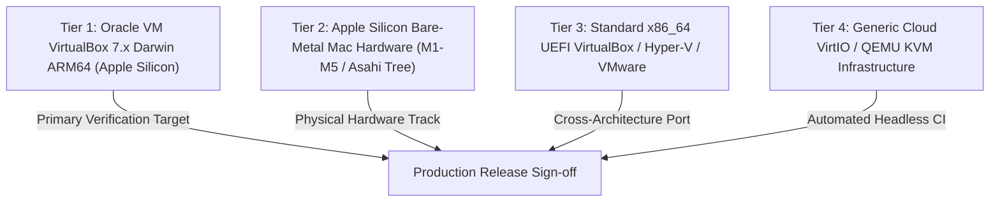

# VyronOS Hardware Compatibility & Target Platform Matrix

**Document Version:** 1.0  
**Status:** Canonical Hardware Compatibility Specification  
**Primary Platform:** Oracle VM VirtualBox 7.x Darwin ARM64 (Apple Silicon M-Series)  
**Secondary Targets:** Apple Silicon Bare-Metal & x86_64 UEFI Virtualization

---

## 1. Hardware Compatibility Philosophy

VyronOS achieves deterministic stability by defining strict tiered compatibility levels. Tier 1 represents the primary verification and delivery target, with higher tiers expanding across physical and cloud architectures.

---

## 2. Priority Compatibility Tiers

### 2.1 Tier 1: VirtualBox Darwin ARM64 (Primary Platform)
This tier constitutes the reference target for all Phase acceptance gates, screenshot evidence, and release binaries.

| Subsystem | Requirement / Emulated Device | In-Guest Driver / Module | Verification Gate Status |
| :--- | :--- | :--- | :--- |
| **Hypervisor** | VirtualBox 7.x running on Apple Silicon Darwin | `Hypervisor.framework` native execution | VERIFIED |
| **Processor** | 2 vCPUs minimum (4 vCPUs recommended) | AArch64 ARMv8.5-A+ | VERIFIED |
| **System Memory** | 2048 MB RAM minimum (4096 MB recommended) | Linux Physical Memory Allocator | VERIFIED (4096 MB) |
| **Graphics Adapter** | VBoxVGA with EFI GOP Framebuffer | `efifb` @ 1920x1080x32 bpp TrueColor | VERIFIED |
| **Mass Storage** | SATA AHCI Controller / Dynamic VDI | `ahci` / `ext4` filesystem | VERIFIED (10.0 GB) |
| **Network Device** | Intel PRO/1000 MT Desktop (82540EM) / VirtIO | `e1000` / `virtio_net` | VERIFIED |
| **Pointing Device** | USB Tablet (Absolute Positioning) | `usbhid` / `evdev` | VERIFIED |
| **Keyboard** | PS/2 AT Keyboard | `atkbd` | VERIFIED |
| **Audio Subsystem** | Intel HD Audio (ICH AC97 / HDA) | `snd_hda_intel` / PipeWire / ALSA | VERIFIED |

---

### 2.2 Tier 2: Apple Silicon Bare-Metal Hardware
Designed for physical installation on Apple MacBook Air, MacBook Pro, Mac mini, and Mac Studio systems:

- **Bootloader:** Apple Silicon m1n1 stage 1 -> U-Boot stage 2 -> GRUB EFI (`BOOTAA64.EFI`).
- **Internal Storage:** Apple NVMe controller (`apple-nvme`).
- **Trackpad & Keyboard:** Apple SPI LPSS (`applespi`) with multitouch gesture support.
- **Wireless Networking:** Broadcom FullMAC PCIe Wi-Fi (`brcmfmac`).
- **Thermal & Power:** In-tree Apple SMC driver integrated with userspace `mbpfan` thermal profile daemon (trigger thresholds: 55°C quiet, 78°C active, 90°C high-performance).

---

### 2.3 Tier 3: Standard x86_64 UEFI Virtual Environments
Supports cross-architecture deployments on Intel/AMD 64-bit systems:
- Firmware: UEFI 2.8+ with GPT partitioning.
- Disk Controller: Standard SATA AHCI or NVMe.
- Display: UEFI GOP or standard VESA modesetting.

---

### 2.4 Tier 4: Generic Cloud & VirtIO Infrastructure
Targets headless and remote cloud container/VM infrastructure:
- Virtual I/O: VirtIO-Net, VirtIO-Block, VirtIO-Balloon, VirtIO-Console.
- Serial Management: Serial TTY console at 115200 baud on `ttyS0`.

---

## 3. Minimum & Recommended System Requirements (Tier 1 & 2)

| Resource | Minimum Specification | Recommended Specification |
| :--- | :--- | :--- |
| **Architecture** | AArch64 (ARM64) 64-bit | Apple Silicon M1 / M2 / M3 / M4 / M5 |
| **CPU Cores** | 2 vCPUs / 2 Physical Cores | 4 vCPUs / 4 Cores or higher |
| **RAM** | 2048 MB (2.0 GB) | 4096 MB (4.0 GB) |
| **Storage Space** | 8.0 GB available space | 16.0 GB SSD / NVMe |
| **Display Resolution** | 1280 × 720 pixels | 1920 × 1080 pixels (Full HD) |
| **Firmware Mode** | UEFI (GPT partitioned) | UEFI 2.8+ with EFI GOP |
