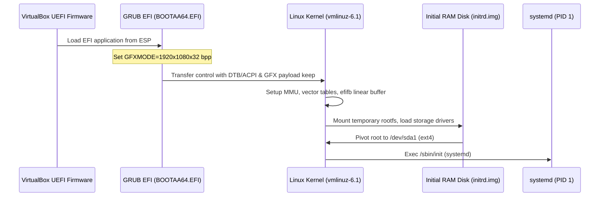
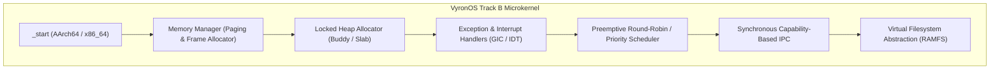

# VyronOS Kernel Architecture Specification

**Document Version:** 1.0  
**Status:** Canonical Kernel Specification  
**Foundation:** Linux 6.1 LTS (Track A) & Bare-Metal Rust Microkernel Research (Track B)  
**Curriculum Alignment:** [Operating-System-Concepts](https://github.com/sujeetjagtap/Operating-System-Concepts)

---

## 1. Architectural Overview & Two-Track Strategy

VyronOS employs a disciplined, bifurcated kernel strategy:

1. **Track A (Production Subsystem):** Built on the robust Linux 6.1.0-56-arm64 Long Term Support (LTS) kernel. Track A provides complete POSIX compliance, VirtualBox Apple Silicon hypervisor integration, UEFI GOP framebuffer acceleration, high-performance networking, and native hardware driver support.
2. **Track B (Bare-Metal Research Subsystem):** An independent bare-metal research kernel written in pure Rust located in `VyronOS-Research/RustKernel/`. Track B serves as the foundation for the future native Vyron microkernel, implementing educational and theoretical principles from *Operating System Concepts*.

---

## 2. Track A: Production Kernel Architecture (Linux 6.1 ARM64)

### 2.1 Boot Sequence & Handover
The boot sequence transitions through distinct phases from hypervisor initialization to userspace handover:

### 2.2 Memory Management Subsystem
- **Paging Architecture:** ARM64 4-level paging (P4D, PGD, PUD, PMD, PTE) with 48-bit Virtual Addressing and 48-bit Physical Addressing.
- **Page Size:** Standard 4 KiB granularity.
- **Kernel/User Isolation:** Strict hardware privilege level separation (`EL1` for Kernel mode, `EL0` for Userspace).
- **Protection Attributes:** Mandatory `W^X` (Write XOR Execute) memory enforcement, user-space pointer authentication, and kernel page table isolation (KPTI).

### 2.3 Process Management & Scheduling
- **Scheduler:** Completely Fair Scheduler (CFS) utilizing red-black trees with nanosecond virtual runtime accounting.
- **Preemption Model:** Voluntary preemption (`CONFIG_PREEMPT_VOLUNTARY=y`) providing optimal throughput with low desktop latency.
- **Control Groups:** Full cgroups v2 hierarchy for memory, CPU, and I/O resource containment of desktop sessions and background daemons.

### 2.4 Device Driver Architecture & Virtual Filesystems
- **Framebuffer Driver:** `efifb` linear EFI GOP framebuffer initialized at `1920x1080x32` with a stride of 7680 bytes.
- **Input Drivers:** Unified Linux Input Subsystem (`evdev`) processing PS/2 keyboard and VirtualBox Absolute USB Tablet pointing events.
- **Virtual Filesystems:**
  - `/proc`: Kernel state, per-process telemetry (`/proc/[pid]/stat`, `/proc/meminfo`).
  - `/sys`: Device tree and driver sysfs hierarchy (`/sys/class/drm`, `/sys/class/net`).
  - `/dev`: Dynamic device node management via `systemd-udevd`.

---

## 3. Track B: Bare-Metal Rust Kernel Research Architecture

Track B is engineered within `VyronOS-Research/RustKernel/` as an independent microkernel implementation. It mirrors the fundamental principles outlined in *Operating System Concepts* (Silberschatz et al.).

### 3.1 Research Modules & Curriculum Mapping

| Module | Core Responsibility | OS Concepts Curriculum Reference |
| :--- | :--- | :--- |
| **`boot`** | Multiboot2 / UEFI GOP initialization, entry point transition | Chapter 1 & 2: Introduction & OS Structures |
| **`mm`** | Physical frame allocator (Bitmap), 4-level page table mapping, heap | Chapter 9 & 10: Main Memory & Virtual Memory |
| **`task`** | Task Control Block (TCB), context switching, preemptive scheduler | Chapter 3, 4 & 5: Processes, Threads & CPU Scheduling |
| **`sync`** | Spinlocks, ticket locks, and wait-queue condition variables | Chapter 6 & 7: Synchronization Tools & Examples |
| **`ipc`** | Microkernel capability-based message passing | Chapter 3.5: Interprocess Communication |
| **`drivers`** | UART serial console driver, VirtIO-Block, VirtIO-GPU | Chapter 12 & 13: I/O Systems & Storage Management |

### 3.2 Track B Implementation Rules
1. **Zero External Crates:** Core kernel logic uses only `core` and `alloc`; zero dependencies on third-party runtime crates.
2. **Safety Invariants:** All `unsafe` blocks must feature explicit safety precondition assertions.
3. **Isolation Rule:** Track B development never modifies or breaks the operational Track A production image.
