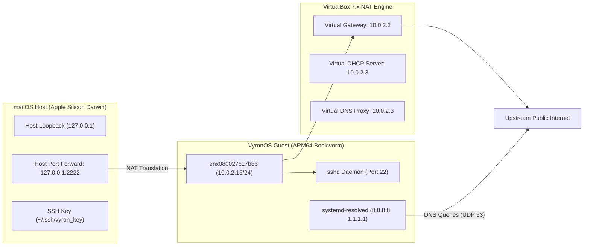
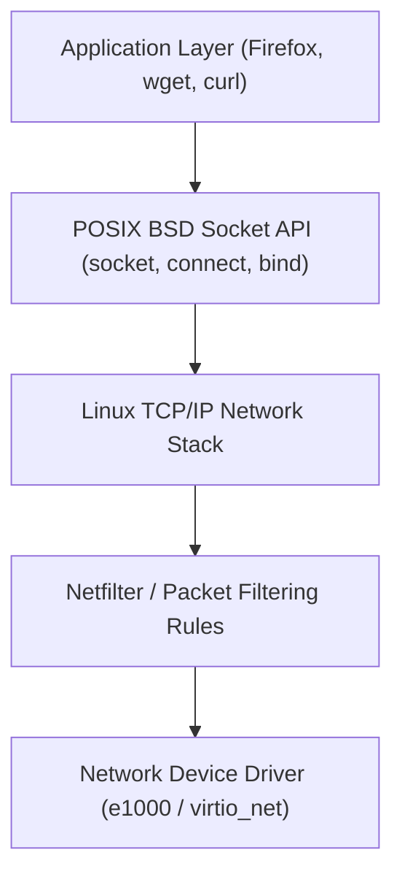

# VyronOS Network Architecture Specification

**Document Version:** 1.0  
**Status:** Canonical Network Specification  
**Architecture Target:** VirtualBox NAT & Standard TCP/IP POSIX Subsystems  
**DNS Resolver:** `systemd-resolved` (IPv4 Prioritized)

---

## 1. Network Topology & Virtualization Model

VyronOS operates within an isolated Network Address Translation (NAT) topology hosted on Apple Silicon VirtualBox 7.x:

---

## 2. IP Addressing & Route Configuration

### 2.1 Interface Bindings
- **Primary Interface:** `enx080027c17b86` (Predictable Network Interface Name generated from VirtualBox MAC `08:00:27:C1:7B:86`).
- **IP Address:** `10.0.2.15/24` dynamically leased via VirtualBox DHCP.
- **Default Gateway:** `10.0.2.2` via `enx080027c17b86` (metric 100).
- **Loopback:** `lo` bound to `127.0.0.1/8` and `::1/128`.

### 2.2 DNS Subsystem & IPv4 Prioritization
Due to hypervisor NAT limitations with IPv6 DNS forwarders on Darwin Apple Silicon, VyronOS enforces IPv4 precedence:
- **Resolver Daemon:** `systemd-resolved` listening locally on `127.0.0.53:53`.
- **Upstream Nameservers:**
  1. Primary: `8.8.8.8` (Google Public DNS)
  2. Secondary: `1.1.1.1` (Cloudflare Public DNS)
  3. Fallback: `8.8.4.4`
- **APT Transport Configuration:** `/etc/apt/apt.conf.d/99force-ipv4` sets `Acquire::ForceIPv4 "true";` ensuring package mirrors never stall on unroutable IPv6 interfaces.

---

## 3. Host-Guest Communication Architecture

Automated testing harnesses, file transfers, and remote management communicate through a hardened SSH channel:
1. **Host Port Forwarding Rule:**
   - Rule Name: `GuestSSH`
   - Protocol: `TCP`
   - Host IP: `127.0.0.1` | Host Port: `2222`
   - Guest IP: `10.0.2.15` | Guest Port: `22`
2. **Cryptographic Authentication:**
   - Key Algorithm: `ED25519` (`~/.ssh/vyron_key`).
   - Root & User Authorization: Key deployed to `/root/.ssh/authorized_keys` and `/home/vyron/.ssh/authorized_keys` with `0600` permissions.
   - BatchMode Support: Enables passwordless, non-interactive execution for CI/CD test gates.

---

## 4. Socket Layer & Network Security Policies

### 4.1 Security Boundaries
- **No Insecure Protocols:** Telnet, RSH, and unencrypted FTP are strictly purged.
- **Non-Root Socket Binding:** Non-privileged user processes (such as `vyron`) cannot bind to privileged ports (`< 1024`).
- **Loopback Isolation:** X11 server listening on UNIX sockets only (`/tmp/.X11-unix/X0`); TCP listening for X11 is disabled (`-nolisten tcp`).
- **Audit Logging:** All incoming connection attempts to port 22 are logged to `/var/log/auth.log` with source IP and authentication outcome.
