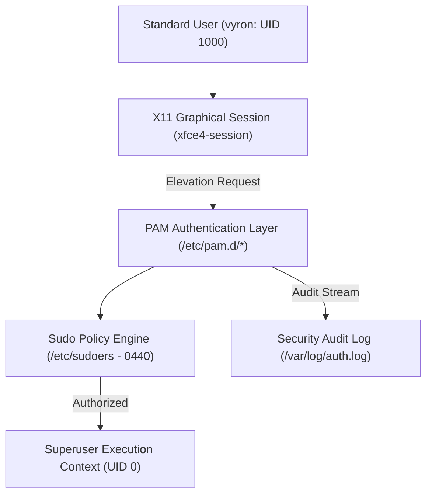

# VyronOS Security Subsystem & Hardening Specification

**Document Version:** 1.0  
**Status:** Canonical Security Specification  
**Security Model:** Least Privilege Separation & Mandatory Audit Logging  
**Audit Target:** PAM `/var/log/auth.log` & Strict Sudoers Validation

---

## 1. Threat Model & Security Principles

VyronOS is architected around three foundational security axioms:
1. **Zero Root Desktop Execution:** No graphical application (browser, terminal, editor, file manager) runs under UID 0 (`root`).
2. **Explicit Privilege Escalation:** Administrative access requires explicit cryptographic or PAM-authenticated password elevation via `sudo`.
3. **Immutable Audit Trails:** All authentication events (successful and failed login attempts, sudo invocations) are logged to `/var/log/auth.log`.

---

## 2. Privilege Separation Architecture

### 2.1 User Accounts & Role Separation
- **`root` (UID 0 / GID 0):** Dedicated system supervisor. Direct remote SSH login with password is disabled (`PermitRootLogin prohibit-password` or key-only).
- **`vyron` (UID 1000 / GID 1000):** Primary interactive user. Belongs to groups `vyron`, `sudo`, `audio`, `video`, `plugdev`, `netdev`, and `input`.
- **System Service Accounts:** Daemons execute under isolated unprivileged system accounts (e.g., `systemd-resolve`, `messagebus`, `_apt`, `lightdm`).

### 2.2 Sudoers Hardening & Verification
The `/etc/sudoers` file and drop-in configurations in `/etc/sudoers.d/` enforce strict operational security:
- **File Permissions:** Strictly set to `0440` (`-r--r-----`) owned by `root:root`.
- **Syntax Validation:** All edits must be validated against `visudo -c`.
- **Environment Isolation:** `env_reset` and `secure_path="/usr/local/sbin:/usr/local/bin:/usr/sbin:/usr/bin:/sbin:/bin"` prevent PATH hijacking.

---

## 3. Pluggable Authentication Modules (PAM) & Audit Logging

### 3.1 PAM Stack Configuration
The PAM stack manages access across multiple interfaces:
- `/etc/pam.d/common-auth`: Configures `pam_unix.so` with SHA-512 password hashing (`obscure sha512 rounds=65536`).
- `/etc/pam.d/lightdm-autologin`: Directs automated login for desktop seat 0 directly into the unprivileged `vyron` user account.
- `/etc/pam.d/sudo`: Mandates password validation and logs authentication failures.

### 3.2 Audit Logging Subsystem
- **Daemon:** `rsyslogd` (System Logging Service) listening on `/run/systemd/journal/syslog`.
- **Destination:** `/var/log/auth.log` with restricted permissions `0640` owned by `root:adm`.
- **Verification Criteria:**
  1. Failed password attempts via `su` or `sudo` produce immediate `pam_unix(sudo:auth): authentication failure` records.
  2. Non-zero exit code (`rc != 0`) is enforced when an invalid credential is submitted.

---

## 4. Filesystem Permission Hierarchy

VyronOS enforces standard POSIX directory permission invariants to defend against privilege escalation:

| Directory Path | Owner | Group | Mode | Security Rationale |
| :--- | :--- | :--- | :--- | :--- |
| **`/bin`, `/sbin`** | `root` | `root` | `0755` | Executable integrity; user cannot replace system binaries |
| **`/usr`, `/usr/bin`** | `root` | `root` | `0755` | System library and binary integrity |
| **`/etc`** | `root` | `root` | `0755` | System configuration protected from unauthorized tampering |
| **`/etc/sudoers`** | `root` | `root` | `0440` | Read-only to root and sudo group |
| **`/var/log/auth.log`** | `root` | `adm` | `0640` | Audit trail integrity; protected from regular users |
| **`/tmp`, `/var/tmp`** | `root` | `root` | `1777` | Sticky bit enabled; users can only delete their own files |
| **`/home/vyron`** | `vyron` | `vyron` | `0700` | Private user space |

---

## 5. Network Access & Remote Hardening

1. **Host-Guest SSH Access:**
   - Host uses ED25519 elliptic-curve cryptography (`~/.ssh/vyron_key`).
   - Host key checks and known hosts isolation prevent man-in-the-middle attacks across test runs.
2. **X11 Socket Protection:**
   - UNIX socket directory `/tmp/.X11-unix` is configured with `1777` sticky permissions.
   - TCP listeners are disabled by default (`-nolisten tcp`).
