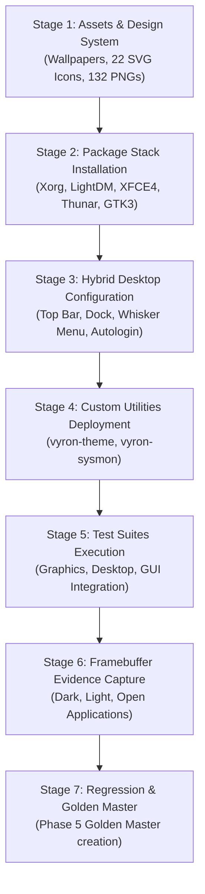

# Vyron UI V1 Implementation Plan

## 1. Executive Summary
This document defines the implementation roadmap for **Vyron UI V1 (Phase 5: Desktop Environment & GUI Integration)** for **VyronOS**, directly fulfilling the technical specifications defined in [`VYRON_UI_V1_DESIGN_SPEC.json`](file:///Users/sujayv/Downloads/VyronOS/VYRON_UI_V1_DESIGN_SPEC.json).

Vyron UI V1 delivers a premium, cohesive hybrid Linux desktop environment combining macOS visual aesthetics (top menu bar, centered dock, clean typography, minimalist window styling) with Windows workflow usability (Start launcher, search, taskbar running indicators, categorized application access) running natively on **Oracle VM VirtualBox**.

---

## 2. Architectural Principles & Constraints

1. **Zero Mockery / No Web Fake:** Absolutely no browser-based simulation, HTML/Electron wrappers as desktop, or fake graphical mockups. The desktop runs genuinely inside Oracle VM VirtualBox with Xorg, XFCE4, XFWM4, and LightDM.
2. **Preserve Golden Masters:**
   - Phase 1 backup: `/Users/sujayv/Downloads/VyronOS_BACKUP_PHASE1`
   - Phase 2 verified disk: `dist/VyronOS-Disk-Phase2-Verified.qcow2`
   - Phase 3 verified disk: `dist/VyronOS-Disk-Phase3-Verified.qcow2`
   - Phase 4 verified disk: `dist/VyronOS-Disk-Phase4-Verified.qcow2`
   - Phase 5 working disk: `dist/VyronOS-Disk.qcow2`
   - Phase 5 golden master: `dist/VyronOS-Disk-Phase5-Verified.qcow2`
3. **Dual Kernel Persistence:**
   - Default: Linux 6.12.95 LTS (Debian Bookworm Backports)
   - Fallback: Linux 6.1.0-56 LTS
4. **Honest System Telemetry:** System monitoring displays authentic data from `/proc`, `/sys`, `vyron-hwinfo`, and `NetworkManager`. No hardcoded wireless SSIDs or simulated hardware.
5. **Direct VirtualBox Framebuffer Evidence:** All screenshots are captured directly from the virtual framebuffer via `VBoxManage controlvm <vm> screenshotpng`, producing verifiable visual proof.

---

## 3. Implementation Stages

### Stage 1: Assets & Design System
- Wallpapers: `vyron-dark.png` (charcoal/slate gradient with electric blue V emblem) and `vyron-light.png` (silver/white gradient with slate blue V emblem) at 1920x1080.
- Icon Family: 22 geometric minimalist icons defined in SVG and pre-rendered across 16x16, 22x22, 24x24, 32x32, 48x48, and 64x64 PNGs.
- Dual Theme: Dark (Greybird-dark base, `#111318` background, `#7C8CFF` accent) and Light (Greybird base, `#F3F5F8` background, `#596BEB` accent).

### Stage 2: Display & Desktop Stack Installation
- Packages installed via guest apt:
  - `xserver-xorg-core`, `xserver-xorg-video-all`, `x11-xserver-utils`, `xinit`
  - `lightdm`, `lightdm-gtk-greeter`
  - `xfce4-session`, `xfwm4`, `xfce4-panel`, `xfdesktop4`, `xfce4-settings`
  - `thunar`, `xfce4-terminal`, `xfce4-whiskermenu-plugin`
  - `greybird-gtk-theme`, `python3-gi`, `python3-gi-cairo`, `gir1.2-gtk-3.0`
- LightDM autologin configured for user `vyron` with `xfce` session.

### Stage 3: Hybrid Desktop Configuration
- **Panel 1 (Top Bar - macOS style):**
  - Height: 32px, Width: 100%, Position: Top.
  - Left: Vyron Logo launcher button (Whisker Menu), Application Menu, Window Title.
  - Right: System tray, Network status indicator, Clock/Date, Power action menu.
- **Panel 2 (Floating Dock - macOS / Windows hybrid style):**
  - Height: 60px, Width: dynamic/centered, Position: Bottom floating.
  - Launchers: Files (`thunar`), Terminal (`xfce4-terminal`), System Monitor (`vyron-sysmon`), Settings (`xfce4-settings-manager`).
  - Running application indicators enabled.

### Stage 4: Custom Desktop Utilities
- `/usr/local/bin/vyron-theme`:
  - Python 3 CLI engine supporting `dark`, `light`, `switch`, `status`, `--json`.
  - Atomically modifies XFCE GTK theme, XFWM4 window border theme, panel styling, and wallpaper via `xfconf-query`.
  - Persists state in `~/.config/vyron/theme.state` across reboots.
- `/usr/local/bin/vyron-sysmon`:
  - Native GTK3 live telemetry monitor with clean CLI fallback.
  - Queries `/proc/stat`, `/proc/meminfo`, `df -h`, and `nmcli` for honest system reporting.

### Stage 5: Verification & Framebuffer Capture
- `test-graphics.sh`: Validates VirtualBox VBoxSVGA graphics controller, 128MB VRAM, EFI firmware, USB HID pointer/keyboard, and NAT network adapter.
- `test-desktop.sh`: Boots into VirtualBox GUI, captures live screenshots of Dark and Light modes directly from framebuffer (`VBoxManage controlvm ... screenshotpng`).
- `test-gui-integration.sh`: Validates `vyron-theme` engine, `vyron-sysmon` live telemetry, desktop shortcuts, and captures running applications screendump.

### Stage 6: Regression Verification & Golden Master
- Verification of Phase 4 filesystem markers, `vyron-storage`, `vyron-hwinfo`, and network connectivity.
- Golden Master created: `dist/VyronOS-Disk-Phase5-Verified.qcow2` (1.85 GiB).
- Deliver comprehensive reports: `docs/PHASE5_IMPLEMENTATION_REPORT.md` and `docs/CHATGPT_PHASE5_REPORT.md` (copied to clipboard).
