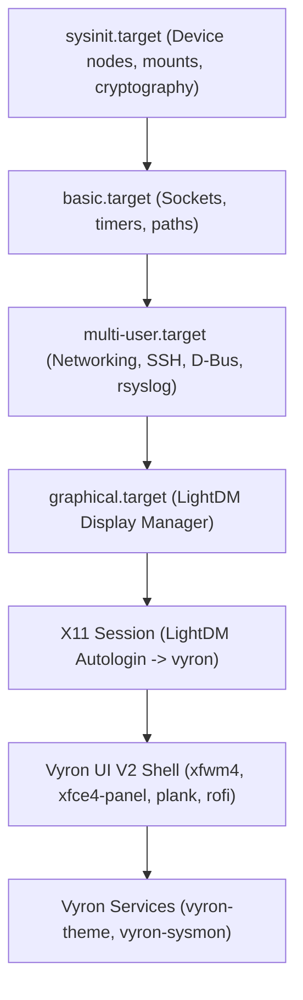
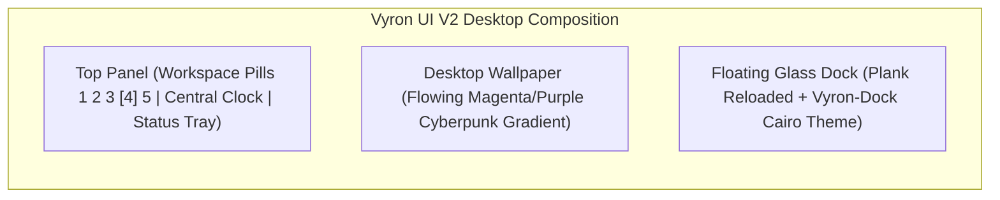

# VyronOS Userspace & Desktop Architecture Specification

**Document Version:** 1.0  
**Status:** Canonical Userspace Specification  
**Desktop Environment:** Vyron UI V2 (XFWM4 + Plank + XFCE Panel + Rofi)  
**Session Manager:** LightDM Display Manager

---

## 1. System Initialization & Service Topology

VyronOS userspace is managed by `systemd` (PID 1), adhering to a modular, target-oriented service architecture:

### 1.1 Critical System Services

| Service Name | Unit Type | Responsibility | Security Context |
| :--- | :--- | :--- | :--- |
| **`systemd-resolved`** | Service | DNS caching, split DNS, and fallback resolver (`8.8.8.8`, `1.1.1.1`) | `systemd-resolve` unprivileged user |
| **`rsyslog`** | Service | System logging daemon, security audit stream (`/var/log/auth.log`) | Root, restricted permissions `0640` |
| **`dbus`** | Socket/Service | Inter-process message bus for system and session events | `messagebus` system user |
| **`lightdm`** | Service | Display manager and X11 seat controller | Root supervisory daemon |
| **`ssh`** | Service | Secure shell daemon on port 22 (NAT forwarded to host:2222) | Privilege separation daemon |
| **`polkit`** | Service | Administrative elevation policy controller | `root:polkitd` restricted execution |

---

## 2. Desktop Shell Architecture (Vyron UI V2)

Vyron UI V2 is engineered as a modern, unified desktop shell providing a sleek translucent aesthetic without superfluous window clutter.

### 2.1 Top Status Bar (`xfce4-panel`)
The top panel spans the full display width (1920px) at a compact height of 28px, styled via GTK3 CSS:
- **Left Sector:** Vyron identity launcher button and workspace navigation pills (`1 2 3 [4] 5`). Active workspace is highlighted with a rounded translucent pill (`#8B5CF6`).
- **Center Sector:** Centered digital clock and date format (`Day HH:MM AM/PM`).
- **Right Sector:** Compact system telemetry tray (Bluetooth, Network, Audio volume, Battery indicator, and Power session control).

### 2.2 Floating Glass Dock (`plank`)
The bottom dock provides rapid application switching and launcher access:
- **Engine:** Plank Reloaded leveraging Cairo ARGB rendering.
- **Theme:** Custom `Vyron-Dock` theme featuring 24px corner radius, `#161122` translucent glass background (opacity 0.90), subtle border highlights, and 1.25x zoom magnification on hover.
- **Ordered Launcher Items (Strict Specification):**
  1. `firefox.dockitem` — Firefox ESR Web Browser
  2. `code.dockitem` — Code Studio IDE
  3. `thunar.dockitem` — Thunar File Manager
  4. `terminal.dockitem` — Vyron Terminal
  5. `music.dockitem` — Audio Player
  6. `notes.dockitem` — Notes & Text Editor
  7. `chrome.dockitem` — Chromium Web Browser
  8. `mascot.dockitem` — Vyron Discord Mascot Launcher
  9. `appgrid.dockitem` — Application Grid Launcher (`rofi -show drun`)

### 2.3 Application Launcher (`rofi`)
Invoked via Super key or the App Grid dock item, Rofi provides a fullscreen/centered modal launcher styled with the `vyron.rasi` stylesheet:
- Translucent dark glass backdrop with blurred background.
- Dual-column application grid with high-resolution Papirus vector iconography.
- Fuzzy search filter across system utilities, developer tools, and multimedia.

---

## 3. Original Vyron System Utilities

### 3.1 `vyron-theme` (Dual-Theme Synchronization Engine)
- **Path:** `/usr/local/bin/vyron-theme`
- **Language:** Python 3 (Native POSIX)
- **Functions:**
  - `dark`: Activates dark palette, sets dark GTK theme, loads `vyron-dark.png` wallpaper, configures dark Plank and Rofi styling.
  - `light`: Activates light palette, sets light GTK theme, loads `vyron-light.png` wallpaper, configures light dock styling.
  - `switch`: Dynamically toggles between dark and light modes.
  - `status`: Outputs current active theme mode and color profile.
  - `--json`: Provides machine-readable theme telemetry for shell scripts and status bars.

### 3.2 `vyron-sysmon` (Real-Time System Monitor)
- **Path:** `/usr/local/bin/vyron_sysmon.py`
- **Language:** Python 3 + GTK3 / Cairo
- **Functions:**
  - Real-time CPU core utilization tracking via `/proc/stat`.
  - Memory saturation, swap usage, and cache footprint tracking via `/proc/meminfo`.
  - Process telemetry table with sorting by CPU and RSS memory consumption.
  - Network interface packet/throughput monitoring via `/proc/net/dev`.

---

## 4. Visual Design Tokens & Palette

| Token Name | Dark Mode Value | Light Mode Value | Usage Description |
| :--- | :--- | :--- | :--- |
| **`bg-base`** | `#0F081D` | `#F8F9FA` | Primary background color |
| **`bg-surface`** | `#1A102F` | `#FFFFFF` | Window surface & panel background |
| **`accent-primary`** | `#8B5CF6` (Violet) | `#6366F1` (Indigo) | Active workspace pill, focus rings |
| **`accent-secondary`** | `#EC4899` (Pink) | `#D946EF` (Fuchsia) | Gradient flowing accents, notifications |
| **`text-primary`** | `#F9FAFB` | `#111827` | High-contrast body text |
| **`text-muted`** | `#9CA3AF` | `#6B7280` | Inactive icons, timestamps, captions |
| **`border-glass`** | `rgba(255,255,255,0.12)` | `rgba(0,0,0,0.08)` | Translucent borders, dock edge |
