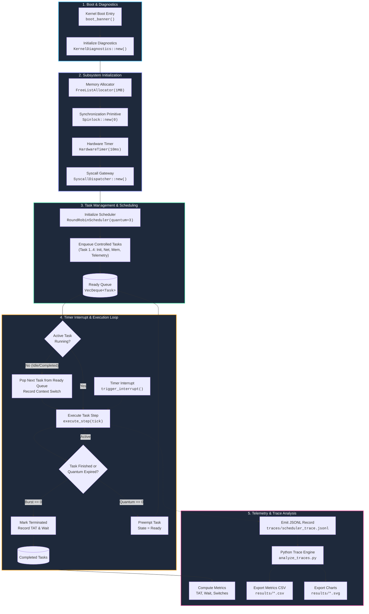

# VYRON Micro-OS: System Architecture Specification

**Author:** SREEHARAN  
**Curriculum Alignment:** Dr. Sujeet Jagtap — Continuous Assessment CA-6 (Section 8, 9, 24)  
**System Type:** Modular 10-Layer Educational Micro-Kernel in Rust  

---

## 1. High-Level Architectural Flow

VYRON Micro-OS models the complete low-level lifecycle from cold boot through task completion and telemetry analysis. The architecture enforces strict unidirectional data and control flow across its 10 subsystems.



---

## 2. Layer-by-Layer Subsystem Breakdown

### Layer 1: Boot Entry Subsystem (`src/kernel/mod.rs`)
- **Responsibility:** Issues kernel identification proclamation, validates instruction set architecture (x86_64 SMP), and transitions execution into early kernel space.
- **Contract:** Pure initialization without heap memory dependence.

### Layer 2: Kernel Diagnostics & Logging (`src/kernel/mod.rs`)
- **Responsibility:** Monotonic timestamp generation via `Instant::now()` formatted to $1\,\mu\text{s}$ precision. Provides structured event logging with enum levels (`Info`, `Warn`, `Error`, `Trace`).
- **Data Invariant:** Monotonically non-decreasing timestamps ($t_{k+1} \ge t_k$).

### Layer 3: Task Abstraction & Hardware PCB (`src/task/mod.rs`)
- **Responsibility:** Encapsulates the Process Control Block:
  - `id`: Unique PID.
  - `state`: Explicit state machine (`Ready`, `Running`, `Blocked`, `Terminated`).
  - `priority`: Scheduling priority class (`Low`, `Normal`, `High`).
  - `context`: Simulated register state (`[u64; 8]`, `instruction_pointer`, `stack_pointer`).
  - `burst`: Total and remaining execution ticks.
  - `telemetry`: Wait time, turnaround time, arrival and completion timestamps.

```mermaid
stateDiagram-v2
    [*] --> Ready: Task::new() & enqueue_task()
    Ready --> Running: Scheduler pop_front() & dispatch
    Running --> Running: execute_step() [Burst > 0 && Quantum > 0]
    Running --> Ready: Quantum Expiry [push_back to Ready Queue]
    Running --> Blocked: Spinlock Contention (yield / lock spin)
    Blocked --> Ready: Lock Acquired / Signal
    Running --> Terminated: execute_step() [Burst == 0]
    Terminated --> [*]: Recorded in completed_tasks
```

### Layer 4 & 5: Ready Queue & Round Robin CPU Scheduler (`src/scheduler/mod.rs`)
- **Responsibility:** Manages FIFO runnable task queue using an amortized $\mathcal{O}(1)$ `VecDeque`. Enforces the configurable time quantum ($q=3$).
- **Preemption Rule:** When a task runs for $q$ consecutive ticks without terminating, it is demoted to `Ready` and returned to the tail of the queue.

### Track A Specialization: Multi-Level Feedback Queue (MLFQ)
- **Responsibility:** 3-tier priority queues with dynamic feedback demotion and anti-starvation aging:
  - **Queue 0 (Highest):** Quantum = 2 ticks (Interactive I/O workloads).
  - **Queue 1 (Medium):** Quantum = 4 ticks (Standard compute).
  - **Queue 2 (Lowest):** Quantum = 8 ticks (Long-running batch compute).
  - **Anti-Starvation Aging:** Every $T_{\text{boost}} = 12$ ticks, all tasks across $Q_1$ and $Q_2$ are elevated to $Q_0$.

### Layer 6: Timer-Driven Interrupt Scheduling (`src/timer/mod.rs`)
- **Responsibility:** Models an 8254 PIT / APIC timer delivering periodic ticks at $10\,\text{ms}$ intervals. Drives quantum countdowns and context-switch evaluations.

### Layer 7: Concurrency & Spinlock Synchronization (`src/sync/mod.rs`)
- **Responsibility:** SMP mutual exclusion primitive protecting shared memory structures without heap allocation in critical sections.
- **Mechanism:** `AtomicBool` test-and-set via `swap(true, Ordering::Acquire)` with `std::hint::spin_loop()`. Exposes an RAII `SpinlockGuard` that automatically unlocks on `Drop`.

### Layer 8: Dual Memory Allocators (`src/memory/mod.rs`)
- **Bump Allocator (`BumpAllocator`):** Fast monotonic pointer incrementation with power-of-two alignment arithmetic.
- **Free-List Allocator (`FreeListAllocator`):** Linked block manager implementing First-Fit allocation, dynamic block splitting, address-sorted deallocation, and adjacent block coalescing.

### Layer 9: System Call Interface Boundary (`src/syscall/mod.rs`)
- **Responsibility:** Safe kernel boundary gate translating simulated user requests into kernel actions:
  - `SYS_WRITE (1)`: Console write bridge.
  - `SYS_YIELD (2)`: Voluntary time-slice release.
  - `SYS_GETPID (3)`: Caller PID retrieval.
  - `SYS_ALLOC (4)`: Memory allocation request.
  - `SYS_EXIT (5)`: Voluntary task termination.
  - Wildcard: Returns standard POSIX negative errno (`Err(-1)` / `ENOSYS`).

### Layer 10: Integrated Execution & Python Telemetry Loop (`src/main.rs`)
- **Responsibility:** Arms all subsystems, runs the complete workload, captures tick-by-tick event logs to `traces/scheduler_trace.jsonl`, and feeds the Python analysis and visualization engine.
