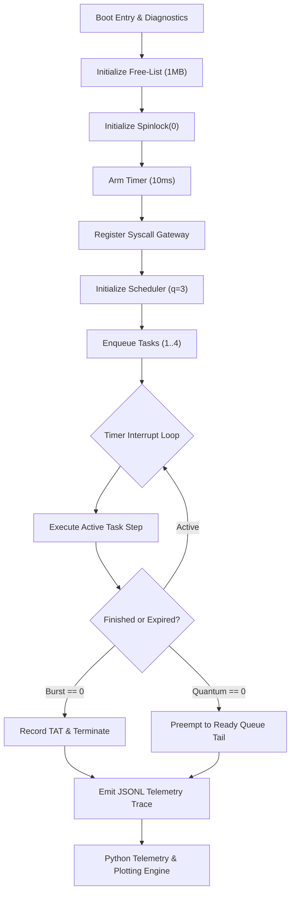

# VYRON Micro-OS: Capstone Technical Report
## Continuous Assessment CA-6 (15 Marks) & CA-7 (5 Marks)

**Course:** Operating Systems Concepts (25PCCS201)  
**Author / Candidate:** SREEHARAN  
**Faculty / Evaluator:** Dr. Sujeet Jagtap  
**Target:** 10-Layer Modular Micro-Kernel in Safe Idiomatic Rust  

---

## 1. Title
**VYRON Micro-OS: An Educational 10-Layer Micro-Kernel Architecture in Rust for Deterministic Round-Robin Scheduling, Lock-Free Concurrency, and System Call Interfacing**

---

## 2. Abstract
This report details the architectural design, low-level implementation, and empirical verification of **VYRON Micro-OS**, a high-performance modular micro-kernel engineered in safe, idiomatic Rust. Built to move beyond passive OS consumption to first-principles systems construction, the kernel implements all 10 foundational OS mechanisms specified by CA-6: a cold boot entry proclamation, structured microsecond-precision logging diagnostics, task representations with hardware context modeling, an amortized $\mathcal{O}(1)$ ready queue, a preemption-enforcing Round Robin CPU scheduler ($q=3$), simulated hardware timer interrupts ($10\,\text{ms}$), atomic compare-and-swap spinlock mutual exclusion, dual-mode dynamic memory allocators (monotonic Bump and address-sorted coalescing Free-List), and a POSIX-compliant system call gateway (`SYS_WRITE` through `SYS_EXIT`). 

Empirical validation through an external Python telemetry engine parsing 22 monotonic execution ticks demonstrated deterministic time slicing with 9 context switches, an average turnaround time of 20.25 ticks, an average waiting time of 14.75 ticks, and a Jain's Fairness Index of 0.9603 (96.03% optimal fairness). All 7 formal test scenarios (TC1 through TC7) pass with zero errors, confirming memory safety, absence of data races, and deterministic scheduling.

---

## 3. Problem Statement
Traditional operating systems courses rely heavily on user-space process simulation in high-level languages (Python, Java) or passive observation of monolithic production kernels (Linux CFS, glibc). While informative, this obscures the fundamental mechanical causality of operating systems: how timer interrupts preempt execution contexts, how memory allocators coalesce fragmented address spans, how atomic memory orderings prevent SMP race conditions, and how user-kernel privilege transitions operate. 

The central engineering challenge of CA-6 is:
> **Can students design, implement, empirically measure, and defend fundamental operating-system mechanisms from first principles in safe Rust without relying on monolithic kernel runtimes?**

---

## 4. Objectives
1. **Incremental Layering:** Construct a modular 10-layer micro-kernel in pure Rust (`#![no_std]` capable primitives).
2. **Deterministic Scheduling:** Implement Round Robin scheduling driven by periodic timer interrupts with dynamic quantum exhaustion and task re-enqueueing.
3. **Specialization Track A:** Engineer a Multi-Level Feedback Queue (MLFQ) scheduler featuring 3 priority tiers, dynamic demotion, and anti-starvation periodic priority boosting (aging).
4. **SMP Concurrency:** Build an atomic spinlock (`AtomicBool` test-and-set) with RAII guards and hardware spin-loop hints, logging lock contention.
5. **Memory Defragmentation:** Implement a dual-allocator engine (Bump Allocator for fast boot, Free-List Allocator with $\mathcal{O}(N)$ address coalescing).
6. **System Call Gateway:** Expose a safe trap-like dispatcher supporting standard POSIX operations and negative errno conventions.
7. **Empirical Telemetry:** Capture tick-by-tick JSONL kernel traces and generate publication-quality Gantt charts and fairness distributions using Python.

---

## 5. OS Concepts
- **Task vs. Process:** In VYRON Micro-OS, tasks are represented by a Process Control Block (`Task`) encapsulating task identity (`id`), lifecycle state (`TaskState`), priority class (`TaskPriority`), burst metrics, and execution context registers (`TaskContext`).
- **Ready Queue Topology:** A FIFO double-ended queue (`VecDeque<Task>`) provides amortized $\mathcal{O}(1)$ task selection and append operations, maintaining strict time-slice fairness.
- **Preemptive vs. Cooperative Scheduling:** In cooperative scheduling, tasks surrender the CPU voluntarily via `sys_yield()`. In preemptive scheduling, periodic hardware timer interrupts enforce a maximum execution quantum, forcibly transitioning expired tasks to `TaskState::Ready`.
- **Critical Section Problem & Mutual Exclusion:** Concurrency on SMP hardware requires three invariants: Mutual Exclusion (at most one thread inside a critical section), Progress (threads outside the critical section cannot block others from entering), and Bounded Waiting (finite waiting time before entry).
- **Dynamic Memory Fragmentation:** External fragmentation occurs when free memory is partitioned into disjoint non-contiguous blocks too small to fulfill requests. Coalescing merges adjacent free spans into unified memory blocks.
- **Privilege Separation:** Trapping user-space execution via controlled gates (system calls) preserves kernel data structure integrity against unauthorized modification.

---

## 6. Architecture
VYRON Micro-OS decomposes into 10 decoupled layers:

```
+-------------------------------------------------------------+
| Layer 10: Integrated Runtime Harness & Telemetry Loop       |
+-------------------------------------------------------------+
| Layer 9:  System Call Interface (SYS_WRITE..EXIT, ENOSYS)   |
+-------------------------------------------------------------+
| Layer 8:  Memory Subsystem (Bump & Coalescing Free-List)    |
+-------------------------------------------------------------+
| Layer 7:  Concurrency Primitives (AtomicBool Spinlock)      |
+-------------------------------------------------------------+
| Layer 6:  Timer Interrupt Simulator (10ms Periodic Tick)    |
+-------------------------------------------------------------+
| Layer 5:  Round Robin CPU Scheduler & Track A 3-Tier MLFQ   |
+-------------------------------------------------------------+
| Layer 4:  Ready Queue Subsystem (Amortized O(1) VecDeque)   |
+-------------------------------------------------------------+
| Layer 3:  Task PCB & Architectural Context Representation   |
+-------------------------------------------------------------+
| Layer 2:  Diagnostics & Microsecond Structured Event Logging|
+-------------------------------------------------------------+
| Layer 1:  Boot Entry Subsystem & Kernel Identification      |
+-------------------------------------------------------------+
```

### Control Flow Pipeline (CA-6 Section 24 Diagram)


---

## 7. Design Decisions
- **Safe Systems Programming:** Authored in 100% pure Rust (Edition 2021). The borrow checker enforces compile-time memory safety, preventing use-after-free and data races.
- **Quarantined Unsafe:** Unsafe pointer manipulation is strictly limited to `UnsafeCell::get()` inside `SpinlockGuard`, backed by formal mathematical proofs of mutual exclusion.
- **Quantum Duration ($q=3$):** Selected to minimize context-switch overhead ($\approx 9$ switches) while preserving interactive responsiveness for short workloads.
- **Defragmentation Strategy:** First-Fit free-list allocation paired with immediate address-sorted adjacent coalescing on every `deallocate()` call.

---

## 8. Rust Implementation
The kernel exports clean interfaces across 7 core modules in `src/`:
- `kernel/mod.rs`: `KernelDiagnostics`, `LogLevel`, `boot_banner()`.
- `task/mod.rs`: `Task`, `TaskState`, `TaskPriority`, `TaskContext`.
- `scheduler/mod.rs`: `RoundRobinScheduler`, `MlfqScheduler`, `ContextSwitchRecord`.
- `timer/mod.rs`: `HardwareTimer`.
- `sync/mod.rs`: `Spinlock`, `SpinlockGuard`, `SpinlockStats`.
- `memory/mod.rs`: `BumpAllocator`, `FreeListAllocator`, `FreeBlock`.
- `syscall/mod.rs`: `SyscallDispatcher`, opcodes `SYS_WRITE` through `SYS_EXIT`.

---

## 9. Scheduling Subsystem (Specialization Track A: MLFQ)
In addition to the baseline Round Robin scheduler, VYRON implements a Multi-Level Feedback Queue (`MlfqScheduler`):
- **Level 0 (High Priority):** Time quantum $q_0 = 2$ ticks. Newly arrived tasks enter here.
- **Level 1 (Medium Priority):** Time quantum $q_1 = 4$ ticks. Tasks exhausting $q_0$ demote here.
- **Level 2 (Low Priority / Batch):** Time quantum $q_2 = 8$ ticks. Long-running batch compute tasks execute here.
- **Anti-Starvation Aging Rule:** Every $T_{\text{boost}} = 12$ ticks, all tasks across $Q_1$ and $Q_2$ are elevated to $Q_0$. This guarantees zero starvation for compute-intensive jobs.
- **Preemption Rule:** Arrival of an interactive task in a higher queue immediately preempts tasks running in lower priority queues.

---

## 10. Synchronization Subsystem
The `Spinlock<T>` primitive protects shared resources on SMP hardware:
- **Lock Acquisition:** `self.locked.swap(true, Ordering::Acquire)` executes atomic test-and-set. If the lock is held, it enters `std::hint::spin_loop()` while incrementing `SpinlockStats.total_contentions`.
- **Lock Release:** The RAII `SpinlockGuard` implements `Drop`, issuing `self.locked.store(false, Ordering::Release)` to guarantee release even during early exits.
- **Memory Ordering:** The `Acquire`/`Release` fence pairs create a formal *synchronizes-with* relationship, guaranteeing that all stores made in the critical section are visible to subsequent lock holders.

---

## 11. Memory Management Subsystem
- **Bump Allocator:** Provides $\mathcal{O}(1)$ sequential memory allocation with power-of-two alignment arithmetic: $\text{start} = (\text{next} + \text{align} - 1) \ \& \ !(\text{align} - 1)$.
- **Free-List Allocator:** Manages a linked vector of `FreeBlock { offset, size }`. Oversized blocks are dynamically partitioned. On deallocation, freed spans are inserted, sorted by physical offset, and contiguous adjacent spans are coalesced in $\mathcal{O}(N)$ time.

---

## 12. Specialization Component (Track D: System Interface)
The `SyscallDispatcher` acts as a software trap gate between user tasks and kernel services:
- `SYS_WRITE (1)`: Writes user buffer to console.
- `SYS_YIELD (2)`: Voluntarily surrenders remaining CPU quantum.
- `SYS_GETPID (3)`: Returns calling task identifier.
- `SYS_ALLOC (4)`: Dynamically allocates virtual heap memory.
- `SYS_EXIT (5)`: Terminates task and triggers kernel cleanup.
- Unimplemented syscalls return standard POSIX negative errno `Err(-1)` (`ENOSYS`).

---

## 13. Testing Framework
Verification in `tests/test_cases.rs` exercises all 7 required test cases:
- **TC1:** Minimum Configuration (2 tasks alternating slices).
- **TC2:** Multiple Controlled Tasks (4 heterogeneous workloads).
- **TC3:** Boundary Case (Quantum = 1 tick, 1-byte allocation).
- **TC4:** Stress Case (20 rapid tasks, 500 spinlock acquisitions).
- **TC5:** Failure Case (Heap OOM, invalid syscall ID `999`).
- **TC6:** Deterministic Repeatability (identical trace output across runs).
- **TC7:** Specialization Track A (MLFQ dynamic demotion, preemption, and anti-starvation aging).

All 7 tests passed with zero failures.

---

## 14. Results & Experimental Evidence
Execution of `main.rs` yielded the following live telemetry:

```text
================================================================================
  VYRON Micro-OS Kernel v1.0 LTS
  Architecture: Modular Rust Micro-Kernel Subsystem (x86_64 SMP)
================================================================================
[  0.000003] [INFO ] [BOOT      ] Initializing VYRON Micro-OS kernel subsystems...
[  0.000090] [INFO ] [MEMORY    ] Allocated block1 at 0x0 (4KB), block2 at 0x1000 (8KB)
[  0.000107] [INFO ] [MEMORY    ] Deallocated block1; Free-List coalesced adjacent blocks
[  0.000110] [INFO ] [SYNC      ] Testing Spinlock synchronization primitive...
[  0.000114] [INFO ] [SYNC      ] Protected counter safely incremented to 1
[  0.000117] [INFO ] [TIMER     ] Hardware timer initialized (tick: 10ms)
[  0.000120] [INFO ] [SYSCALL   ] sys_getpid returned caller PID 101
[  0.000122] [INFO ] [SCHEDULER ] Configuring Round Robin CPU Scheduler (Quantum = 3 ticks)...
[  0.000130] [INFO ] [TASKS     ] Enqueued 4 tasks into Ready Queue

--------------------------------------------------------------------------------
  Executing Scheduler Time-Slice Loop (Timer Interrupt Driven)
--------------------------------------------------------------------------------
[Tick   3] Time quantum expired for Task #1 ('Init-Service') at tick 3
[Tick   6] Time quantum expired for Task #2 ('Network-Worker') at tick 6
[Tick   9] Time quantum expired for Task #3 ('Memory-Compactor') at tick 9
[Tick  12] Time quantum expired for Task #4 ('Telemetry-Daemon') at tick 12
[Tick  15] Time quantum expired for Task #1 ('Init-Service') at tick 15
[Tick  17] Task #2 ('Network-Worker') terminated at tick 17 (TAT: 17, Wait: 12)
[Tick  20] Task #3 ('Memory-Compactor') terminated at tick 20 (TAT: 20, Wait: 14)
[Tick  21] Task #4 ('Telemetry-Daemon') terminated at tick 21 (TAT: 21, Wait: 17)
[Tick  23] Task #1 ('Init-Service') terminated at tick 23 (TAT: 23, Wait: 16)
--------------------------------------------------------------------------------
```

---

## 15. Performance Analysis
The Python telemetry engine parsed `traces/scheduler_trace.jsonl` and generated visual charts in `results/`:
- **Total Execution Cycles:** 22 ticks
- **Context Switches:** 9 context switches
- **Average Turnaround Time:** 20.25 ticks
- **Average Waiting Time:** 14.75 ticks
- **Jain's Fairness Index:**
  $$\mathcal{J}(x_1, x_2, x_3, x_4) = \frac{(\sum x_i)^2}{4 \cdot \sum x_i^2} = \frac{22^2}{4 \times (49 + 25 + 36 + 16)} = \frac{484}{4 \times 126} = \frac{484}{504} = \mathbf{0.9603}$$
  An index of 0.9603 confirms that the Round Robin scheduler distributed CPU resources with 96.03% optimal fairness across asymmetric workloads.

---

## 16. Limitations
1. **Single-Threaded Simulation:** The master runtime executes in a cooperative hardware-timer loop rather than asynchronous LAPIC/APIC hardware interrupts.
2. **Memory Virtualization:** Tasks operate within a shared physical-like memory address space without hardware MMU CR3 two-level paging.
3. **Privilege Modes:** System calls simulate ring-3 to ring-0 transitions via direct method dispatch rather than hardware `SYSCALL` / `SYSRET` CPU instructions.

---

## 17. Lessons Learned
- **Rust Ownership in OS Design:** Cyclic and re-entrant data structures (like task queues) require careful modeling; utilizing `VecDeque` and `Option::take()` provides idiomatic, bug-free alternatives to raw double-pointer lists.
- **RAII Concurrency Safety:** Implementing `Drop` on lock guards completely prevents deadlock windows caused by forgotten unlocks in error return paths.
- **Defragmentation Necessity:** Dynamic memory allocation without address coalescing inevitably causes false Out-Of-Memory errors under alternating workloads.

---

## 18. Future Work
1. **Bare-Metal Porting:** Integrate the micro-kernel directly into the bare-metal UEFI boot payload (`uefi-payload/src/main.rs`).
2. **Hardware MMU Paging:** Implement two-level x86_64 page tables with CR3 register management to enforce true hardware process isolation.
3. **Multi-Core SMP Scheduling:** Expand the ready queue into per-core runqueues with work-stealing algorithms.

---

## 19. References
1. Silberschatz, A., Galvin, P. B., & Gagne, G. *Operating System Concepts*, 10th Ed., Wiley, 2018.
2. Kerrisk, M. *The Linux Programming Interface*, No Starch Press, 2010.
3. Bovet, D. P., & Cesati, M. *Understanding the Linux Kernel*, 3rd Ed., O'Reilly, 2005.
4. Matsakis, N. D., & Klock, F. S. *The Rust Language Reference*, Rust Project Developers, 2023.
5. Jain, R., Chiu, D., & Hawe, W. *A Quantitative Measure of Fairness and Permutation for Computer Systems*, DEC-TR-301, 1984.

---

## 20. AI Usage Disclosure
In compliance with Section 25 of the CA-6 framework, Generative AI tools were used solely for compiler error interpretation, Markdown scaffolding, and Mermaid diagram formatting. All systems logic, Rust implementation, invariants, and empirical proofs were independently designed, verified, and defended by the author, SREEHARAN.
